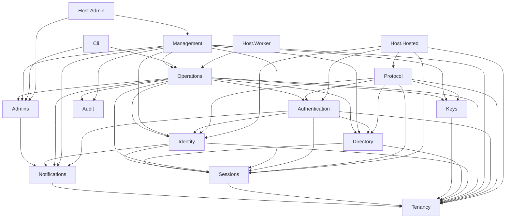
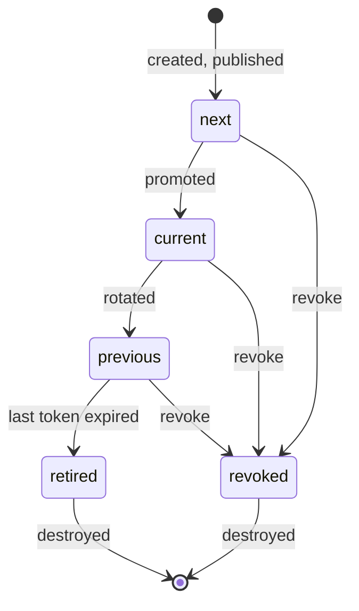
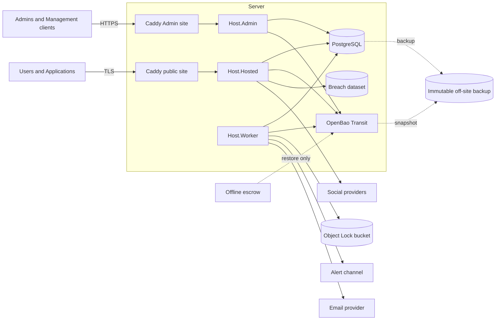
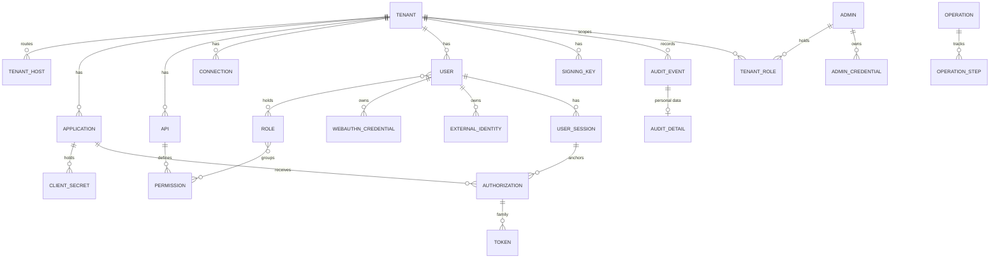

# Architecture Spine — Gatekeep

Terms follow PRD §3 exactly. `[ASSUMPTION]` marks a call made on the fast path that Esm hasn't confirmed.

## Design Paradigm

**Modular monolith, hexagonal inside each module.** One domain core, deployed as three hosts and one CLI that differ by network exposure and database role. Modules talk through published contracts. Infrastructure sits behind ports.

| Layer | Lives in | May depend on |
| --- | --- | --- |
| Host and CLI | `src/Gatekeep.Host.*`, `src/Gatekeep.Cli` | Modules, adapters |
| Module contract | `src/Modules/*/Contracts` | Kernel only |
| Module core | `src/Modules/*/Core` | Own contract, contracts it has an edge to, Kernel |
| Adapter | `src/Modules/*/Adapters`, `src/Adapters/*` | Own module core, external libraries |
| Kernel | `src/Gatekeep.Kernel` | Nothing inside Gatekeep |

## Invariants & Rules

Every arrow is one allowed direct dependency. Transitive reach grants nothing. Every module also depends on Kernel, not drawn.



### AD-1 — Dependency direction

- **Binds:** all
- **Prevents:** a module reaching into another's tables or types, so the Tenant boundary and audit path can't be bypassed from the side.
- **Rule:** The diagram and the architecture tests are generated from one edge list in `tests/Architecture`. A dependency not listed fails the build. A module's tables are queried only by its own adapters. Foreign keys may cross modules only as composite keys, or as a single-column key to `tenant`, with `ON DELETE RESTRICT`. Cross-module deletion is an Operation (AD-30), never a cascade. A host's composition root may also reference any module's adapter registration. It's used only to wire ports.

### AD-2 — Three hosts, three trust zones

- **Binds:** FR-8, FR-42, FR-46, NFR-5, §9 server compromise
- **Prevents:** an internet-facing flaw reaching Admin functions or changing Tenant security configuration.
- **Rule:**
  - `Host.Hosted` serves Tenant Subdomains only: OIDC endpoints, Hosted Login and the Account Portal.
  - `Host.Admin` serves the Admin Dashboard and Management API, reachable only through Caddy's Admin site on its own public hostname. **Amended 2026-11-02 (public Admin, `sprint-change-proposal-2026-11-02-public-admin.md`):** the Admin surface faces the internet; WebAuthn-only sign-in, fresh assertions, rate limits, CSP and CSRF checks are its controls, and an internet-facing flaw in `Host.Admin` is no longer stopped by network position.
  - `Host.Worker` has no inbound port except health. `Gatekeep.Cli` runs only as the `cli` Compose service, with its own role and no published port.
  - Admin routes aren't registered in `Host.Hosted`, and Hosted Login routes aren't registered in `Host.Admin`.
  - Database grants are an allow-list per table and column in the AD-3 registry. A grant not listed fails the catalogue test.
  - `gk_hosted` has no `SELECT` on `admin*`, `tenant_role` or `deployment_*` tables, and no write on configuration or Signing Key tables. `user.blocked_at` is writable only by `gk_admin` and `gk_worker`. `user.password_reset_required` and `user.totp_reset_required` are set only by `gk_worker` and `gk_cli`, and `gk_hosted` may only clear them.
  - Writes that the public path must make but which change no configuration live in separate tables, such as `client_usage` for FR-42 last use.
  - Containers share default-deny networks. `Host.Hosted` has no route to `Host.Admin`, and a release test proves this from inside its container.

### AD-3 — Tenant isolation in the database

- **Binds:** FR-7, FR-8, SM-2
- **Prevents:** one missed filter exposing another Tenant's data.
- **Rule:** Shared database, shared schema, PostgreSQL row-level security.
  - Every table is listed in a registry with its class (`tenant` or `control`), owning module and grants. A table missing from the registry fails CI.
  - `tenant` tables have `tenant_id uuid NOT NULL`, `ENABLE` and `FORCE ROW LEVEL SECURITY`, one permissive policy `USING (true) WITH CHECK (true)`, and one `RESTRICTIVE` policy `USING` and `WITH CHECK` `tenant_id = current_setting('gatekeep.tenant_id')::uuid`.
  - The failing cast is deliberate. An unscoped query raises an error rather than returning nothing.
  - Foreign keys between `tenant` tables are composite and include `tenant_id`.
  - Runtime roles are `gk_hosted`, `gk_admin`, `gk_worker`, `gk_dispatch`, `gk_sealer`, `gk_retention` and `gk_cli`. None owns a table or holds `BYPASSRLS` or superuser. `gk_migrator` owns the schema, connects only during `gatekeep migrate` or `gatekeep upgrade`, and scopes any data migration one Tenant at a time, because `FORCE` applies to it.
  - A CI catalogue test asserts all of the above from `pg_class`, `pg_policies`, `pg_roles` and `information_schema`. A behaviour test shows a scoped role sees its own row and no other Tenant's.

### AD-4 — Tenant scope

- **Binds:** FR-8, FR-9
- **Prevents:** code running with an implied, inherited or missing Tenant.
- **Rule:**
  - `TenantScope` in Kernel is the only way to reach `tenant` tables. It opens a transaction and calls `set_config('gatekeep.tenant_id', $id, true)`. Session-level `SET` and PgBouncer are forbidden.
  - One scope holds one Tenant. Cross-Tenant work runs as one scope per Tenant, never as a wider query.
  - The Tenant comes from the resolved host (AD-6), the URL path (AD-19), the job row (AD-15) or a Cli command's iteration of `tenant`. It's never taken from a session, cookie or token claim alone.
  - A table is `control` only if it has no meaning inside one Tenant, as named in AD-27. Tenant configuration is `tenant` class.

### AD-5 — One mutation path

- **Binds:** all writes, FR-40, FR-45, NFR-5
- **Prevents:** a state change without an audit event, or an event for a change that rolled back.
- **Rule:**
  - A state change is any write to a logged table, except these operational writes, which are exempt from audit but not from AD-3: Session idle touches, WebAuthn sign counts, TOTP last-used steps, `client_usage`, `rate_usage`, `service_status`, job and `operation_step` state, seal columns and UNLOGGED counters. Adding one needs an AD change.
  - Every state change is a command in one `CommandContext` (AD-28), which writes the state, its audit event and any jobs together. Authorization runs in the handler, not only in the route. Handlers are plain classes; MediatR isn't used.
  - A refused request that must leave a durable effect commits it in a separate short `FailureContext` after the rollback. That covers failed sign-in events, lockout state and attempt counts, and the revocations caused by refresh token reuse and code replay, which commit even though the response is an error. A `FailureContext` is a `CommandContext` in every other respect.
  - OpenIddict's store writes run in a `CommandContext` opened by the first Gatekeep handler on the request and committed when the endpoint finishes.

### AD-6 — Tenant resolution from the host

- **Binds:** FR-7, FR-8, SEC-27, SEC-28, NFR-21
- **Prevents:** a forged `Host` header selecting a Tenant or poisoning an email link.
- **Rule:**
  - Tenant Subdomains are `{subdomain}.{zone}`. The zone is used only by Gatekeep and doesn't share a registrable domain with any Application or mail host.
  - The Admin hostname sits outside the zone.
  - Caddy terminates TLS. Its public site forwards only hostnames under the zone, and its Admin site (AD-26) serves only the Admin hostname. `Host.Hosted` resolves the whole host, lower-cased, by exact match on the `tenant_host` control table. No code parses a subdomain out of a host.
  - An unknown host gets one fixed 404 before any Tenant code runs. A resolved host for a deleted Tenant gets the same 404.
  - The issuer, WebAuthn RP ID and email link base are read from the stored Tenant record, never from the request.
  - `tenant_host` rows are never deleted, so a Tenant Subdomain can't be reused. Reserved names live in a code-owned list.
  - Forwarded addresses are honoured only from the Caddy network address.

### AD-7 — Custom-domain seam

- **Binds:** FR-21 note, §7.1 row 11 (v2)
- **Prevents:** v1 hard-coding the host shape, which would force a rewrite in v2.
- **Rule:** `tenant_host` carries a `kind` column (`subdomain` in v1) and one Tenant can hold several rows. Issuer and RP ID are Tenant columns, independent of which host served a request. No v1 screen, route or certificate logic exposes custom domains.

### AD-8 — OpenIddict is the protocol engine, wrapped

- **Binds:** FR-12, FR-13, FR-23, FR-24
- **Prevents:** a request using Deployment-level credentials or request-derived issuers, or endpoints being reimplemented alongside the library.
- **Rule:**
  - OpenIddict owns the authorization, token, userinfo, revocation, end-session, discovery and JWKS endpoints on Tenant hosts.
  - The first Gatekeep handler on each request replaces `context.Transaction.Options` with a per-Tenant copy and sets `BaseUri` from the stored issuer. No later code reads global options.
  - Global signing and encryption credentials are inert keys that throw. A test asserts they never reach a JWKS or a token.
  - Sign-in hands off through two contracts: Protocol calls `IAuthentication.Begin`, which creates the `signin_transaction`, and later receives an `AuthenticationResult` holding the Session, `amr` and `auth_time`. Protocol alone issues codes.
  - OpenIddict's stores are custom. Each store lives in its owner's adapters: the application store in Directory, and the authorization and token stores in Sessions (AD-13). The scope store isn't used; a Gatekeep handler validates scopes against APIs.
  - Client authentication is a Gatekeep handler calling Directory's contract, which reads `client_secret`, which allows FR-12 overlap. OpenIddict's secret column stays empty.
  - OpenIddict entity caching is disabled and its pruning isn't used. Pruning is a job (AD-15).
  - The first story of the OIDC core epic is a spike proving this end to end (see Open Items).

### AD-9 — Token formats

- **Binds:** FR-13, FR-15, FR-23, FR-43, A-16
- **Prevents:** an algorithm or format that fails conformance, or per-Application drift.
- **Rule:**
  - Every Tenant signs access and ID tokens with RS256 using RSA-3072. It's one Deployment-wide constant, not a setting. OIDC Core §15.1 makes RS256 mandatory for this product. `[ASSUMPTION: key size]`
  - Access tokens are JWS with `typ: at+jwt` and access token encryption disabled.
  - Authorization codes and refresh tokens are reference tokens, so only a lookup value leaves the server. Their internal protection uses the Tenant's token protection key (AD-10), not an RSA key.
  - Every opaque artifact Gatekeep issues is `{tenantPublicId}.{random}`, with at least 256 random bits. A mismatch with the serving Tenant is rejected before any lookup.
  - Unauthenticated mismatches increment a counter and write at most one Log event per source per hour, so nobody can flood the SM-2 signal. Authenticated cross-Tenant attempts always write a Log event.

### AD-10 — Key custody with OpenBao

- **Binds:** FR-4, FR-37, FR-38, NFR-3, UJ-6
- **Prevents:** private signing keys or the Master Key sitting in an internet-facing process, on the database disk or in a backup.
- **Rule:** `[ASSUMPTION: replaces cloud KMS, which FR-1 rules out]`
  - OpenBao Transit runs as a Compose service with Raft storage on its own volume, attached to no network and reachable only over a unix socket on a shared volume. It holds non-exportable keys.
  - Each Signing Key is its own Transit key. Each Tenant has separate Transit keys per secret class: `totp` (TOTP seeds and pending Recovery Codes), `social` (social provider credentials), `email` (email provider credentials), `payload` (credential-equivalent job payloads), `hmac`, and a wrap key for the token protection key. The Deployment has its own `email`, `payload` and `hmac` keys for Admin flows.
  - Signing happens in OpenBao, and no host process holds private signing material.
  - The token protection key is a per-Tenant random 256-bit key, wrapped by Transit. `Host.Hosted` may hold it unwrapped in memory for up to 5 minutes. This is the only cached key.
  - Secrets are stored as Transit ciphertext with the Tenant ID as `associated_data`, not `context`, which non-derived keys ignore. A value is decrypted only at the moment of use.
  - `Host.Hosted` may sign with Signing Keys, encrypt `totp` and `payload`, decrypt `totp` and `social`, compute `hmac`, and unwrap the token protection key. `Host.Admin` may create Signing and Management keys, sign with the Management key (AD-33), encrypt `social`, `email` and `payload`, and compute the Deployment `hmac`. It decrypts nothing. `Host.Worker` may create, rotate and delete keys, wrap the token protection key, decrypt `social`, `email` and `payload`, and sign off-server records with the Deployment key. `Gatekeep.Cli` has its own policy: create, rotate, rewrap and delete keys, encrypt `social` and `email`, and sign and verify off-server records. Nobody may export.
  - OpenBao runs an audit device whose output goes off the server, with decrypt-rate alerts per host. Per-host quotas apply if the spike confirms support.
  - The barrier key is the Master Key. **Amended 2026-11-02 (Docker only, `sprint-change-proposal-2026-11-02-docker-only.md`):** the static seal key is a 32-byte file on the Docker host, outside every data volume and backup, delivered to the OpenBao container as a read-only Compose secret. It is never in an image, environment variable, data volume, log, repository or backup. Root or Docker access on the host reads it, so this is a weaker control. It replaces the earlier root-only key file and the TPM target, which needed host access Gatekeep no longer has. An offline escrow copy is kept apart from backups, alongside the recovery keys, and every escrowed generation is kept until the last backup that needs it has expired.
  - This protects backups. Protection of a stolen disk or a powered-off server depends on the Docker host's disk encryption, which the host owner provides and Gatekeep can't verify. Whether restarts are unattended is the host owner's choice. It doesn't protect against live root or Docker access, which UJ-6 treats as full compromise.
  - Master Key rotation is a rehearsed seal rotation and Transit rewrap, needing no User action.
  - A key's Transit name starts with its purpose, so a policy can separate keys by path: `sig-{tenantId}-{rowId}`, `mgmt-{tenantId}-{rowId}`, `{class}-{tenantId}`, and `dep-{class}` for Deployment keys. A Signing or Management key is created first, named from a pre-generated row ID, and then its row commits. An orphan sweep removes only `sig-` and `mgmt-` keys with no row after 24 hours. Secret class keys have no row, and only Tenant creation and deletion create or destroy them.
  - All access goes through the Kernel `IKeyCustody` port.

### AD-11 — Signing Key lifecycle and JWKS

- **Binds:** FR-37, FR-38, FR-50, UJ-3, V-9
- **Prevents:** a key state that exists only in a cache, or a revoked key staying trusted.
- **Rule:**



  - The `signing_key` row is authoritative, and its `purpose` is `signing` or `management` (AD-33). A state change is one command, so at commit a Tenant has exactly one `current` and one `next` per purpose. Any command that consumes or revokes `next` creates its replacement.
  - JWKS contains the `next`, `current` and `previous` keys with `purpose = signing`, served with `Cache-Control: max-age=900`. `Host.Hosted` may cache it per Tenant for up to 5 seconds, and `NOTIFY` clears that on a state change.
  - Routine promotion needs `next` to have been published at least 15 minutes earlier. A new Tenant may promote at once because nothing has cached its JWKS. `management` keys are never published, so they need no ageing.
  - Revoking `current` promotes `next` even if it's younger than 15 minutes. The Log records that it was unaged. Revoking every key (FR-50) creates and promotes new keys of both purposes in the same Operation.
  - `previous` becomes `retired` once the hard token lifetime plus 15 minutes has passed since rotation.
  - Transit keys are destroyed by a job after commit. A failed destruction retries and raises a Security Alert.
  - A daily job rotates any key within 30 days of the §5.2 maximum age. `[ASSUMPTION: margin]`

### AD-12 — Session and sign-in transaction storage

- **Binds:** FR-14, FR-24, FR-47, FR-48, NFR-3, NFR-4, §5.2
- **Prevents:** session state in a signed cookie that can't be revoked, or skipping a sign-in step.
- **Rule:**
  - User Sessions live in the `user_session` `tenant` table, with only the SHA-256 of a 256-bit identifier stored. It records `amr`, `auth_time`, the Connection used, and idle and absolute expiry.
  - Rotating an identifier (FR-47) replaces the stored hash in the same transaction.
  - A sign-in in progress is a row in `signin_transaction`, owned by Authentication and bound to a browser cookie, the Tenant and the Application. It holds the authorization parameters and completed steps, and is the only source of truth for what may come next.
  - Its sliding lifetime is 30 minutes, per EXPERIENCE. Expired rows stay for one hour, so a new transaction can restart at Login with the email kept.
  - Cookies are `__Host-gk_session` and `__Host-gk_txn`: `Secure`, `HttpOnly`, `SameSite=Lax`, `Path=/`, no `Domain`.
  - Admin sessions use a separate `control` table, a separate `SameSite=Strict` cookie and the Admin hostname.
  - CSRF tokens are bound to the session or transaction and checked with Origin on every state-changing request.
  - The Account Portal's commands belong to Authentication, Identity and Sessions. It authenticates by Session cookie and isn't an OIDC client, which overrides EXPERIENCE line 38. Each Tenant has one system Application, created with the Tenant, hidden from every list and not editable. It exists only so that a Portal sign-in's `signin_transaction` has an Application to bind to, and no code or token is ever issued for it. Password policy checks run in Authentication, which has the edge to Directory.

### AD-13 — Refresh tokens and revocation

- **Binds:** FR-15, FR-16, FR-24, FR-48, FR-50, §5.2
- **Prevents:** a Token Family surviving a credential change, or two definitions of "family".
- **Rule:**
  - Sessions owns the OpenIddict authorization and token entities. Each completed code flow creates one new ad-hoc authorization, anchored to one `user_session`, and that authorization is the Token Family.
  - Rotation happens on every use with no reuse leeway. Reuse revokes every token under that authorization and writes to the Log.
  - Natural Session expiry doesn't end a Token Family, so refresh lifetimes in §5.2 hold. Logout and every FR-48 trigger do. `[ASSUMPTION]` The anchor row stays until its families expire.
  - `ISessions.RevokeAccess(context, scope, exceptSessionId)` is the only revocation path. A generated test walks the FR-48 trigger list and proves each one calls it.
  - Permissions and Roles are read from current state at each refresh.
  - Access tokens aren't revocable. FR-48 relies on the §5.2 lifetime limit.

### AD-14 — PostgreSQL is the only system of record, with no cache tier

- **Binds:** FR-6, FR-8, FR-28, NFR-6, NFR-11, NFR-12
- **Prevents:** Tenant data in a store with no row-level boundary, and revocation state that a cache restart could lose or resurrect.
- **Rule:** `[ASSUMPTION: Redis removed from the proposal]`
  - No Redis, Valkey or second data store in v1.
  - Attempt counters live in `UNLOGGED` `tenant` tables under AD-3, behind the `IRateLimiter` port. A crash resets them, which is acceptable. They aren't relied on in backups. `IRateLimiter` is a Kernel port. Admin attempt counters live in the `UNLOGGED` `control` table `admin_attempt`, owned by Admins, behind the same port.
  - A worker job rolls counters up each minute into the logged `rate_usage` table, which the Dashboard reads for FR-6. `Host.Hosted` flushes its in-memory rejections into those counters each minute, keyed by resolved Tenant.
  - A coarse in-memory per-source limit in `Host.Hosted` rejects floods before they reach PostgreSQL.
  - All Argon2id work passes through a Deployment-wide semaphore with a bounded queue, a short deadline, per-Tenant shares and a reserved floor per Tenant (NFR-6). Concurrency is derived from the memory cost per hash and the container memory limit. On overflow the request gets the generic failure, which reveals no account state. Transit signing has a per-Tenant concurrency share.
  - In-memory caches are allowed only for public, non-credential data, keyed by Tenant, for up to 60 seconds. AD-10's token protection key and AD-11's JWKS cache are named exceptions.

### AD-15 — Jobs

- **Binds:** FR-8, FR-36, FR-45, NFR-3
- **Prevents:** unscoped background work, lost emails, credential values at rest in a queue, or the public host directing the worker.
- **Rule:** `[ASSUMPTION: replaces a separate queue and broker]`
  - Operations owns jobs. Modules enqueue only through the Kernel `IJobEnqueuer` port, in the `CommandContext` transaction.
  - `job` is a `control` table of dispatch columns. `job_payload` is a `tenant` table under AD-3. `Host.Worker` claims with `FOR UPDATE SKIP LOCKED`, and `LISTEN/NOTIFY` wakes it.
  - A check constraint requires exactly one of `tenant_id` or `deployment_wide`. A trigger requires the row's `tenant_id` to match the transaction's scope.
  - A deployment-wide job touches only `control` tables or fans out into one job per Tenant. Its only parameter is an `operation_id` dispatch column.
  - A code-owned registry lists each job type and the roles allowed to enqueue it, enforced by the same trigger. `gk_hosted` can enqueue only notification types, and `gk_sealer` only alert types.
  - Destructive handlers re-check authoritative state before acting and never trust the payload.
  - `gk_dispatch` sees only dispatch columns. A job body runs in its own `TenantScope` under `gk_worker`, except sealing under `gk_sealer` and retention under `gk_retention`, as the registry states.
  - Handlers are idempotent, delivery is at-least-once, retries back off, and exhausted jobs stop in a `dead` state and raise a Security Alert (AD-17). Alert jobs never go `dead`. They retry with capped backoff.
  - A payload that must carry a credential-equivalent value, such as an email link, is Transit ciphertext and is erased when the job finishes. Other payloads carry IDs only. Recipients are IDs too. The Operations send handler resolves the address through Identity or Admins at send time and passes it to Notifications.
  - Recurring work comes from a code-owned schedule in `Host.Worker`, including purging expired transactions and tokens, and Sessions with no live Token Family.

### AD-16 — Audit log

- **Binds:** FR-40, FR-49, NFR-3, NFR-15, V-7
- **Prevents:** tampering going undetected, erasure breaking the chain, or personal data in a tamper-evident record.
- **Rule:**
  - Audit is written only through the Kernel `IAuditAppender` port, on the `CommandContext` connection. No module depends on Audit to write.
  - There's one chain per Tenant in `audit_event` and one Deployment chain in the `deployment_audit_event` `control` table, with the same shape.
  - The envelope holds a stable type code and internal references only. Personal data such as IP address, user agent and email goes in `audit_detail`, outside the hash. Erasure and raw-detail permissions act on that table alone. Personal data for Deployment events goes in `deployment_audit_detail`, with the same rules as `audit_detail`.
  - A sealer in `Host.Worker`, under `gk_sealer`, assigns `seq`, `prev_hash` and `hash = SHA-256(prev_hash || canonical envelope)`. Sealing is separate so a sign-in flood can't serialize on a chain head. The target is 5 seconds. Lag above 60 seconds is reported through the AD-17 heartbeat, which raises the Security Alert.
  - Triggers make the envelope immutable. Roles granted access in the registry have only `INSERT` and `SELECT`, and `gk_sealer` may set only the seal columns, once. `gk_retention` alone deletes `audit_event` rows. `gk_worker` deletes `audit_detail` rows for erasure.
  - Retention deletes whole sealed ranges and writes a checkpoint event carrying the last deleted hash.
  - `gatekeep audit verify` walks the chain and every off-server head. A checkpoint is accepted only if it's past retention and its hash matches the off-server record. A break between epochs is accepted only where a signed restore record names it.
  - Canonical form is RFC 8785 JSON. Event type codes are `{domain}.{object}.{action}`, in lower case, and part of the public contract. They replace the export's short sample codes. The catalogue is a generated file in `docs/`.
  - Log search filters on indexed envelope columns. A User or email search resolves to the internal reference first.
  - A deleted Tenant's chain stays until its retention ends, then an Operation purges it.

### AD-17 — Off-server record and Security Alerts

- **Binds:** FR-4, FR-40, FR-45, UJ-6, SEC-06
- **Prevents:** an intruder rewriting the evidence, or a restore silently undoing revocations.
- **Rule:**
  - Worker jobs copy sealed security events, revocations and one chain head per `(epoch, seq)`, within 60 seconds of sealing, to an S3-API bucket on a separate provider with Object Lock in compliance mode. Retention matches §5.2. The server's credential can write but not delete or shorten retention.
  - Records are signed by a Deployment Transit key that only `Host.Worker` and `Gatekeep.Cli` can use.
  - Replayable revocations are defined in a code-owned table of event types, carrying the internal IDs needed to re-apply them. It covers keys, Token Families, Sessions, Users, Admins, client secrets, password changes, Factor and Passkey removals, and Recovery Code use. A replayed password change sets `password_reset_required`, because the old hash has returned.
  - Security Alerts derive from audit event types through one code-owned table in Notifications, and go through the `IAlertChannel` port to a service outside the Deployment. The Operations sealing job calls Audit to seal a batch, checks the sealed events against that table, and enqueues one alert job per match, keyed on event ID, in the same transaction under `gk_sealer`. An alert therefore can't precede its committed event. A condition with no event writes one first: an exhausted job writes `operations.job.dead` through a `system` Actor.
  - A heartbeat to an external dead-man's check carries the latest sealed and shipped chain positions, the oldest unsealed age and the oldest undelivered alert age, so stalled evidence raises an alert as well as a dead Deployment. `[ASSUMPTION]`

### AD-18 — Backup, restore and upgrade

- **Binds:** FR-3, FR-4, UJ-4, UJ-6, NFR-3, NFR-13, SM-5
- **Prevents:** database and key state disagreeing after a restore, an intruder destroying recovery, or an upgrade with no way back.
- **Rule:**
  - A backup is a nightly pgBackRest encrypted set with WAL archiving, plus an OpenBao snapshot, both off the server and recorded in one manifest with the release version, timestamp and Master Key generation.
  - The server can't delete or overwrite a backup inside its retention of at least 30 days, through Object Lock or a pull from another machine. The method is chosen in the backup story.
  - The repository key is escrowed with the Master Key, and neither is in the backup. The breach dataset isn't backed up.
  - `gatekeep restore` runs on the same version as the backup, with Tenant traffic refused until it completes. It reports the lost-change window and the last shipped `seq`, then:
    1. Reconciles `signing_key` rows against Transit, moving any row with no Transit key to `revoked` and creating replacements.
    2. Verifies the signature on each off-server record, reports and skips any that fail, and replays the rest of the AD-17 revocations.
    3. Unless `--planned-rollback` is given, ends all Sessions, refresh tokens and Admin sessions, and rotates every Signing Key, because the off-server record may be behind.
    4. Writes a signed restore record off the server, naming the restored head of each chain, and starts a new `epoch` for each chain. `--planned-rollback` skips only step 3.
  - `gatekeep rekey`, used for UJ-6 after a restore, replaces Signing Keys, provider and email credentials, and the Master Key, and lists what the Operator must replace by hand.
  - `gatekeep upgrade` refuses to start without a manifest under 24 hours old. It stops the hosts, runs forward-only migrations as `gk_migrator`, then starts the new version. Failure means restore, not down-migration.
  - Restore is Deployment-wide. Recovering one Tenant alone isn't offered in v1.

### AD-19 — API surfaces and versioning

- **Binds:** FR-9, FR-42, FR-46, NFR-5, V-1
- **Prevents:** Dashboard and Management API diverging, a machine client reaching a re-authenticated action, or a stale tab acting on the wrong Tenant.
- **Rule:**

| Surface | Host | Auth | Versioning |
| --- | --- | --- | --- |
| OIDC, OAuth, discovery, JWKS | Hosted | Protocol | Fixed by the standards, unversioned |
| `/login/api/*`, `/account/api/*` | Hosted | Transaction or Session cookie | Private, ships with its bundle |
| `/api/v1/tenants/{tenantId}/*` | Admin | Admin session or Management API token, or client authentication on `/oauth/token` | Public contract |
| `/api/v1/deployment/*` | Admin | Admin session, Deployment Owner | Same contract, no machine access |

  - The Dashboard and Management API are one route set with two authentication schemes.
  - Every Tenant-scoped action names its Tenant in the path, and the Dashboard keeps it in its URL. No server-side "current Tenant" exists. A token's Tenant must equal the path's Tenant.
  - The major version is in the URL. Additive changes stay in `v1`. A breaking change means `v2`, and the old major stays for at least one minor release after its successor. The release's OpenAPI document is committed and diffed in CI, so an unmarked breaking change fails the build.
  - Machine access follows the capability table (AD-20), not a route attribute.

### AD-20 — Admin authorization

- **Binds:** FR-39, FR-42, FR-46, NFR-5
- **Prevents:** the role matrix being re-expressed differently in each handler or in the UI.
- **Rule:**
  - One capability table in the Admins contract is the only encoding of FR-39. Each capability also declares `MachineAllowed` and `FreshAssertion`, which may be a predicate on the target, such as "Application in a Prod Tenant with callback URLs". Handlers evaluate it. This covers creating as well as changing an Application.
  - Every fresh-assertion capability is machine-denied, which closes V-1.
  - The UI reads the caller's capabilities from an endpoint to decide what to show.
  - A generated test denies every role and machine principal every capability outside the table.
  - Management API Permissions can be granted only to machine-to-machine Applications, never through Roles.
  - RBAC for Users (FR-32) is separate and lives in Directory. No authorization engine is used in v1.

### AD-21 — Hosted Login delivery

- **Binds:** FR-33, FR-34, FR-47, NFR-16, NFR-18, EXPERIENCE page-loading assumption
- **Prevents:** a loading flash, a theme flash, step logic in the browser, or Node entering the sign-in path.
- **Rule:**
  - Hosted Login and the Account Portal are one React bundle served by `Host.Hosted` from its own origin. No Node runs in production.
  - The first response embeds the current step as a JSON data block and links the Tenant theme stylesheet in `<head>`, and the client renders from it synchronously with no fetch. The exception is a step carrying a `RevealOnce` value, which the client fetches from `/login/api/*`. The initial bundle stays within a CI-enforced budget of 150 kB compressed. `[ASSUMPTION]`
  - Every response is a `StepResponse`: `step`, `stepVersion`, `expiresInSeconds`, step data and a CSRF token. The client renders what it's told and holds no flow logic. A stale `stepVersion` returns the current valid step. `POST /login/api/transaction/extend` backs "Keep going".
  - Password rules arrive as step data for the strength meter. The server remains authoritative.
  - All responses on these paths set `Cache-Control: no-store`.
  - JavaScript is required. `<noscript>` shows fixed text. This overrides the EXPERIENCE `[ASSUMPTION]` that password and code forms work with JavaScript off.
  - Theme CSS is generated by the server from validated typed values, served same-origin with a content hash in the URL. Validation and colour derivation run only in the Tenancy module.
  - Themes are versioned rows, draft or published. The Dashboard preview renders the shared screen components with draft CSS from `Host.Admin`, under a scope selector that forces each colour scheme.
  - Logos are stored in `tenant_asset`, up to 1 MB. Uploaded SVG is rasterized to PNG by a job and never served as SVG. Assets are served same-origin with a hashed URL, `nosniff` and the sanitized type.
  - CSP on Hosted Login, the Account Portal and the Admin Dashboard is `default-src 'none'; script-src 'self'; style-src 'self'; img-src 'self'; font-src 'self'; connect-src 'self'; form-action 'self'; base-uri 'none'; frame-ancestors 'none'`. A browser test covers it.
  - Leaving the origin, to a social provider or back to an Application, is always a top-level GET navigation, never a form post.
  - The Admin Dashboard is a static bundle served by `Host.Admin`, with the same CSP and no third-party requests.

### AD-22 — Design system as shared packages

- **Binds:** NFR-16, NFR-18, DESIGN.md, FR-34, FR-44
- **Prevents:** token drift between surfaces and between the frontend and the theme generator.
- **Rule:**
  - The `DESIGN.md` frontmatter is the token source. `packages/design-tokens` generates `tokens.css`, a TypeScript map and a C# constants file for the default theme. Values that aren't CSS, such as references and shorthand, are mapped in the generator. CI fails if the output differs from `DESIGN.md`.
  - Tokens are emitted against a scope selector, so a preview can apply a scheme and theme to a subtree.
  - `packages/ui` is React with CSS Modules, emitting static CSS only. It references tokens through CSS custom properties, and raw hex values fail lint. The QR code is the documented exception to no raw values.
  - It has two entry points: `@gatekeep/ui/hosted`, whose only third-party runtime dependency is one reviewed QR encoder rendering SVG elements, and `@gatekeep/ui/admin`, which may use headless accessibility primitives. A surface attribute, not a second component, selects Hosted or Admin sizing.
  - `packages/hosted-screens` holds step screens as props-only components, imported by `apps/hosted-login` and by the Dashboard preview.
  - Fonts ship in `packages/ui` from the Deployment.
  - The `design/*.dc.html` exports and `support.js` are references. No build imports them.
  - Tenant themes override only the DESIGN.md theme contract: `ac`, its dark variant, their derived tokens, font, radius and logo.

### AD-23 — Monorepo layout

- **Binds:** all
- **Prevents:** duplicated clients, multiple release versions, or code placed by habit.
- **Rule:** One repository, one version for every deployable, as laid out in Structural Seed. pnpm workspaces for the frontend, one .NET solution with Central Package Management. No Turborepo or Nx. API clients in `packages/api-client` are generated from the OpenAPI document and never hand-written.

### AD-24 — Credential handling

- **Binds:** FR-12, FR-18, FR-27, FR-29, NFR-2, NFR-3, NFR-20
- **Prevents:** a credential-equivalent value appearing in a log, or modules choosing different hash schemes.
- **Rule:**
  - Passwords use Argon2id, with parameters stored per hash and upgraded at next sign-in.
  - Unknown identifiers run an equivalent dummy hash, to meet NFR-20.
  - High-entropy values are stored as SHA-256: Session IDs, refresh lookups, reset and verification links, and 256-bit client secrets.
  - Low-entropy values are stored as HMAC under the Tenant's Transit `hmac` key: email codes and Recovery Codes. One keyed lookup replaces trying each stored code, so Recovery Codes put no load on the Argon2 budget. Admin Recovery Codes use the Deployment `hmac` key.
  - A `Secret<T>` Kernel type has no serializable form, and any credential-equivalent value in code uses it.
  - `RevealOnce<T>` is the one exception, returned only by a code-listed set of responses: new client secret, Recovery Code display, TOTP setup and the credential enrolment links for Users and Admins. These values never appear in the embedded first-response JSON. A pending value is Transit ciphertext until confirmed.
  - Operational logging runs through a scrubbing sink, and FR-40's canary test also scans operational logs and the database for raw values.
  - The breach dataset is a read-only local file on its own volume, queried only by `Host.Hosted`. Passwords never leave the process.
  - WebAuthn expects the exact RP ID and origin from the stored Tenant record per request, requires user verification and asks for no attestation.

### AD-25 — Release gates

- **Binds:** FR-8, FR-23, FR-43, NFR-7, SM-2, SM-4
- **Prevents:** a release passing with a safety property untested, a malicious package shipping, or conformance weakening production.
- **Rule:**
  - Every release must pass the architecture tests, AD-3 catalogue test, cross-Tenant suite, FR-25 matrix, FR-48 walk, canary scan, negative token pack, OpenAPI diff, dependency scan and OpenID conformance plans.
  - The cross-Tenant suite is driven from route and artifact registries, so a new endpoint or artifact type fails until it's covered.
  - Dependencies install from lockfiles with install scripts disabled. New frontend runtime dependencies need review against an allow-list. Images are built in CI, signed, shipped with an SBOM and deployed by digest. Building and signing are separate CI jobs: the job that runs third-party code holds no secrets, and the signing key is held in hardware by Esm. `gatekeep upgrade` verifies each image signature against a key pinned on the server, and refuses otherwise.
  - Where a conformance plan can't pass FR-13 or FR-24 rules, `GATEKEEP_CONFORMANCE_TENANT` relaxes that rule for one named Dev Tenant. It's evaluated per request. A Deployment refuses to start with it set if any Prod Tenant exists, and labelling a Tenant Prod is refused while it's set. The deviation is recorded per FR-23.

### AD-26 — Deployment and environments

- **Binds:** FR-1, FR-6, NFR-7, NFR-10, NFR-21
- **Prevents:** a Deployment that only works with cloud services, or TLS keys reachable by the application.
- **Rule:** One Docker host running Docker Compose. `[DECISION: Docker only, 2026-11-02]`
  - Every Gatekeep process runs in a container: the hosts, PostgreSQL, OpenBao, Caddy, the CLI, setup and key generation, and the test suite. Nothing is installed on the host but Docker, with pinned, signed images per release. Disk encryption, the host firewall and host access control are host requirements in the install docs, not something Gatekeep sets up.
  - Environments are local (`*.gatekeep.localhost`), CI and production, sharing one Compose definition with different values.
  - Caddy has two sites: the public zone wildcard, and the public Admin hostname, with its own publicly trusted certificate. `[ASSUMPTION]` Certificate private keys are readable only by Caddy.
  - The public DNS credential covers only validation records, by delegating `_acme-challenge` to a validation-only zone. CAA records are set. Certificate Transparency monitoring raises Security Alerts.
  - Only Caddy publishes ports, and the install docs require a host firewall allowing just those. Application egress is limited to `Host.Hosted`, `Host.Worker` and `Gatekeep.Cli`, through one `EgressHttp` handler that blocks private addresses. Infrastructure egress is limited to named endpoints: Caddy to its ACME and DNS providers, and pgBackRest and OpenBao's snapshot and audit shipping to their off-server targets. Social provider endpoints are code-owned constants, never Tenant input.
  - Startup refuses missing or default secrets. Every host exposes `/healthz` on a private port. Operational logs are JSON to stdout, carrying W3C trace IDs, which are the IDs shown to Users.

### AD-27 — Table ownership

- **Binds:** all
- **Prevents:** two modules owning one entity.
- **Rule:** Every table has exactly one owner in the AD-3 registry. A registry entry with no owner fails CI.

| Module | Owns | Class |
| --- | --- | --- |
| Tenancy | `tenant`, `tenant_host` | control |
| Tenancy | `tenant_settings`, `tenant_theme`, `tenant_asset` | tenant |
| Admins | `admin`, `admin_credential`, `admin_recovery_code`, `admin_session`, `admin_invite`, `admin_enrolment`, `admin_attempt`, `tenant_role`, `bootstrap_state` | control |
| Identity | `user`, credential tables (AD-29), `one_time_token` (verification, reset, email change and credential enrolment links), `password_history`, `pending_email_change`, `email_recovery` | tenant |
| Directory | `application`, `client_secret`, `client_usage`, `api`, `permission`, `api_grant`, `role`, `user_role`, `role_permission`, `connection`, `application_connection` | tenant |
| Authentication | `signin_transaction`, `email_code`, attempt counters | tenant |
| Sessions | `user_session`, `authorization`, `token` | tenant |
| Keys | `signing_key` and protection key wraps | tenant |
| Audit | `audit_event`, `audit_detail` | tenant |
| Audit | `deployment_audit_event`, `deployment_audit_detail` | control |
| Notifications | `email_template`, `email_provider` | tenant |
| Notifications | `deployment_email_provider` | control |
| Operations | `job`, `operation`, `operation_step`, `service_status` | control |
| Operations | `job_payload`, `rate_usage` | tenant |

### AD-28 — One command context

- **Binds:** all writes
- **Prevents:** one command splitting across transactions, leaving a change half applied or audited but rolled back.
- **Rule:** Kernel holds `TenantScope`, `CommandContext`, `Actor`, `IAuditAppender`, `IJobEnqueuer`, `IKeyCustody`, `IRateLimiter` and `IWebAuthnVerifier`. A command runs in exactly one `CommandContext`, created only by the outermost handler. Every state-changing contract method takes it as a required parameter and can't open a scope or commit. Each module's `DbContext` enlists on the same connection and transaction.

### AD-29 — Credential model

- **Binds:** FR-17, FR-20, FR-21, FR-26, FR-27
- **Prevents:** one generic credential table in one epic and typed tables in another.
- **Rule:** Identity has typed tables: `password_credential`, `webauthn_credential` with a `kind` of Passkey or security key, `totp_factor`, `recovery_code` and `external_identity`. `external_identity` is keyed on provider issuer and subject. There's no generic credential table. A Tenant has one database Connection in v1, and `user.email` is unique per Tenant. `[ASSUMPTION]`

### AD-30 — Long-running Operations

- **Binds:** FR-7, FR-50, EXPERIENCE incident response, UJ-3, UJ-6
- **Prevents:** partial failure with no record, duplicate runs, or no module able to reach everything.
- **Rule:**
  - Work spanning modules or Tenants is an Operation, owned by the Operations module. That covers Tenant creation and deletion, FR-50 actions, Security notices, and test sends and connection tests.
  - Starting one returns `202` with an `operation` resource, listing one `operation_step` per Tenant or stage with its result. The Dashboard polls it.
  - One active Operation is allowed per scope and type. Each step is idempotent, Retry repeats only failed steps, and a retry of a fresh-assertion Operation needs a new assertion.
  - `operation_step` holds a nullable Tenant ID, a stage, a status and a result code, and no personal data. Every read filters on the path's Tenant, and the cross-Tenant suite covers it.
  - Each module with `tenant` tables exposes a Tenant purge in its contract, and Tenant deletion calls each one. An architecture test fails if AD-27 gives a module `tenant` tables and Operations has no edge to it.
  - Forced password reset and TOTP re-enrolment set `password_reset_required` and `totp_reset_required` on each User holding that credential, which Authentication turns into required steps before any Session is issued. They're separate because a reset link clears only the first. EXPERIENCE specifies the proof each step accepts.
  - A User data export (FR-49) isn't an Operation. `Host.Admin` builds it during the request, through Management's existing edges, and streams it. No copy is stored.
  - Account deletion (FR-35) is a command in `Host.Hosted` that sets `user.deletion_requested_at` and revokes the User's access through `RevokeAccess`, in one `CommandContext`. Authentication refuses a marked User. `Host.Hosted` can't start an Operation, so a recurring Worker job turns each marked User into a deletion Operation, whose handler re-checks the marker (AD-15).

### AD-31 — Admin identity, bootstrap and recovery

- **Binds:** FR-2, FR-5, FR-39, FR-46
- **Prevents:** Admin sign-in sharing code paths with Users, or bootstrap being claimed by whoever arrives first.
- **Rule:**
  - The Admins module owns FR-46 sign-in on `Host.Admin`. It uses the Kernel `IWebAuthnVerifier` port, whose stateless adapter in `src/Adapters/Fido2` takes the RP ID and origin per call and knows no User or Admin types, but no tables or flows from Identity or Authentication. The Admin RP ID is the Admin hostname.
  - `gatekeep init` writes a one-time 256-bit bootstrap token to a root-only file and stores its SHA-256 and a 15-minute expiry in `bootstrap_state`. It can reissue the token until bootstrap completes. `[ASSUMPTION: lifetime]` Only `Host.Admin` accepts it. Consuming it and creating the first Admin is one command that records completion, and the row is never deleted. The route then returns the same 404 as any unknown path. The first Admin can do nothing else until two WebAuthn credentials are registered. No Tenant can exist before bootstrap, so `Host.Hosted` needs no check: AD-6's fixed 404 refuses all traffic. `gatekeep restore` refuses a backup with incomplete bootstrap unless given an explicit flag, which raises a Security Alert.
  - `gatekeep recover-admin` runs in the `cli` container as `gk_cli`. It sends the Security Alert through `IAlertChannel` and writes the off-server record itself, and issues the enrolment only after both are confirmed, so stopping `Host.Worker` can't suppress them. The enrolment for FR-5 is single-use and expires in 15 minutes. `[ASSUMPTION: lifetime]` It then ends that Admin's sessions and writes to the Deployment Log.
  - Admin invites use the provider in `deployment_email_provider`. `Host.Admin` has no egress, so sending is a Deployment-wide job. `job_payload` is a `tenant` table, so the invite link waits in `admin_invite` as Transit ciphertext under the Deployment `payload` key, and is erased once sent.
  - Single-use Admin enrolments from `gatekeep recover-admin` and "Reset credentials" live in the `admin_enrolment` `control` table, which holds the Admin ID, a SHA-256 of the value, an expiry and a used time. A "Reset credentials" enrolment lasts for the §5.2 credential enrolment link lifetime and is returned through `RevealOnce`.

### AD-32 — Operations envelope

- **Binds:** FR-6, NFR-7, NFR-9, NFR-10, SM-5
- **Prevents:** the Operator discovering ownership of routine work during an incident.
- **Rule:**
  - Host provisioning is documented steps in `docs/`, rehearsed on the VM. OS patches are applied monthly, and on a critical advisory.
  - Releases are built in CI from `main`. `deploy/` holds every host-level file, including OpenBao policies.
  - Every runbook in NFR-9 lives in `docs/runbooks`, and SM-5 rehearsals record their result there.
  - Monitoring is external: the dead-man's check, a public probe per Prod Tenant and certificate expiry. `Host.Worker` polls each `/healthz` and writes the `service_status` `control` table owned by Operations, with a timestamp so that a stale row shows as unknown. The Dashboard reads it through Management and Operations.

### AD-33 — Management API token isolation

- **Binds:** FR-8, FR-42, AD-2
- **Prevents:** an RCE on the public host forging a Management API token with a Tenant's Signing Key.
- **Rule:** Management API tokens are `at+jwt` tokens issued only by a Client Credentials endpoint on `Host.Admin`, at `/api/v1/tenants/{tenantId}/oauth/token`, and signed by a per-Tenant Management key. This endpoint isn't OpenIddict. It lives in Management and authenticates clients through the same Directory contract method as AD-8. That key is a `signing_key` row with `purpose = management`, follows AD-11, and never appears in the public JWKS. `Host.Admin` validates Management API tokens only against that Tenant's `management` keys and rejects any token signed by a `purpose = signing` key. The token's `iss` is the Admin endpoint, so it can never equal a Tenant issuer. `Host.Hosted`'s OpenBao policy can't use it. `Host.Hosted`'s token endpoint refuses the Management API audience. Each Tenant lists a built-in API record for FR-16.

## Consistency Conventions

| Concern | Convention |
| --- | --- |
| Naming | PascalCase C#, `snake_case` SQL, kebab-case routes, camelCase JSON. PRD §3 terms in code and copy. |
| Identifiers | UUIDv7 internally. Public IDs are a type prefix plus base32 of the UUID, such as `usr_`, `app_`, `ten_`. `sub`, `{tenantId}` and `{tenantPublicId}` all use the public ID. Never expose a sequence. |
| Time | UTC `timestamptz`; RFC 3339 in JSON. |
| Errors | RFC 9457 `problem+json` with a stable `code` and `traceId`. OIDC endpoints use protocol errors. Hosted Login shows only code and trace ID. |
| Lists | Cursor pagination with a default of 50, matching EXPERIENCE. |
| Limits | §5.2 values are constants in one Kernel file, and every setting validates against them. |
| Text | User-facing strings live in message catalogues, per NFR-19. |
| Migrations | Forward-only SQL through EF Core migrations, which may commit per migration. Every new table includes its registry entry, policies and grants in the same migration. |
| Secrets in config | Injected at runtime only as Compose secrets. Never in environment files in git. |
| Email | A port with SMTP and HTTP adapters. Templates are subject and body text with fixed variable substitution and no template engine. Previews are text only. |

## Stack

Verified against vendor pages on 2026-11-02.

| Name | Version |
| --- | --- |
| .NET SDK / runtime | 10.0.403 / 10.0.14 |
| ASP.NET Core and EF Core | 10.0.14 |
| OpenIddict | 7.7.2 |
| Npgsql.EntityFrameworkCore.PostgreSQL | 10.0.3 |
| Fido2.AspNet | 4.3.2 |
| PostgreSQL | 18.6 |
| OpenBao | 2.7.2 |
| Caddy | 2.11.7 |
| pgBackRest | 2.60.0 |
| Node.js (build only) | 26.13.0 |
| pnpm | 12.16.1 |
| React | 19.3.1 |
| Vite | 8.3.5 |

## Structural Seed





```text
gatekeep/
  Gatekeep.slnx
  Directory.Packages.props
  pnpm-workspace.yaml
  src/
    Gatekeep.Kernel/
    Gatekeep.Host.Hosted/
    Gatekeep.Host.Admin/
    Gatekeep.Host.Worker/
    Gatekeep.Cli/            # init, migrate, upgrade, restore, rekey, audit verify, recover-admin
    Modules/                 # Tenancy, Admins, Identity, Authentication, Sessions, Directory,
                             # Protocol, Keys, Audit, Notifications, Management, Operations
    Adapters/                # OpenBao, Postgres, Fido2, Smtp, AlertChannel, ObjectLock, BreachFile
  apps/
    hosted-login/            # Vite React, Hosted Login and Account Portal
    admin-dashboard/         # Vite React
  packages/
    design-tokens/
    ui/
    hosted-screens/
    api-client/
  tests/
    Architecture/
    Isolation/
    Protocol/                # conformance and negative token pack
    Flows/
  deploy/                    # Compose, Dockerfiles, Caddyfile, OpenBao config and policies
  docs/                      # quickstarts, API reference, threat model, runbooks, ASVS evidence
  design/                    # reference exports, unchanged
```

## Capability → Architecture Map

| Capability / Area | Lives in | Governed by |
| --- | --- | --- |
| FR-1 to FR-6, FR-45 Deployment and operations | Cli, Operations, Notifications, `deploy/` | AD-17, AD-18, AD-26, AD-31, AD-32 |
| FR-7 to FR-10 Tenants | Tenancy, Operations, Management | AD-3, AD-4, AD-6, AD-7, AD-19, AD-30 |
| FR-11 to FR-16 Applications and APIs | Directory, Protocol | AD-8, AD-9, AD-13, AD-33 |
| FR-17 to FR-24, FR-47 Authentication | Authentication, Identity, Sessions, Protocol | AD-8, AD-12, AD-21, AD-24, AD-29 |
| FR-25 to FR-29 MFA and attack protection | Authentication, Identity | AD-12, AD-14, AD-24, AD-29 |
| FR-30 to FR-32, FR-48, FR-49 Users | Identity, Directory, Sessions, Audit | AD-5, AD-13, AD-16 |
| FR-33 to FR-36 Hosted Login and branding | `apps/hosted-login`, Authentication, Identity, Sessions, Tenancy, Notifications | AD-15, AD-21, AD-22 |
| FR-37, FR-38, FR-50 Keys and compromise | Keys, Sessions, Operations | AD-10, AD-11, AD-13, AD-30 |
| FR-39, FR-40, FR-41, FR-46 Administration and audit | Admins, Management, Audit | AD-2, AD-12, AD-16, AD-19, AD-20, AD-31 |
| FR-42, FR-43 Developer experience | Management, `docs/` | AD-19, AD-20, AD-25, AD-33 |
| FR-44 Admin Dashboard | `apps/admin-dashboard` | AD-19, AD-20, AD-21, AD-22 |
| NFR-1 to NFR-9, NFR-20, NFR-21 Security | All | AD-2, AD-3, AD-10, AD-24, AD-25, AD-26 |
| NFR-10 to NFR-13 Reliability and performance | All | AD-14, AD-18, AD-26, AD-32 |
| NFR-14, NFR-15 Privacy and retention | Audit, Identity | AD-16 |
| NFR-16 to NFR-19 Accessibility and platform | `packages/ui`, `packages/hosted-screens`, apps | AD-21, AD-22 |

## Deferred

- **OpenFGA and fine-grained authorization:** PRD places FGA in Later. Revisit when §7.1 row 7 is scheduled.
- **Actions sandbox:** v2 by PRD §6. When built, it runs outside these hosts, with no database or OpenBao access.
- **Custom domains:** v2. The seam is AD-7. Passkey migration needs its own design.
- **Horizontal scale and high availability:** A-4 assumes one server. `IRateLimiter` and `IKeyCustody` are the known seams. Valkey is the expected addition.
- **Public Suffix List:** not submitted in v1. `__Host-` cookies carry the boundary.
- **Back-Channel Logout, sender-constrained tokens, PAR, JAR:** v2 by PRD.
- **Bot defence:** accepted until v2 by PRD §9.
- **Vendors:** object storage, alert channel, email provider and DNS provider are chosen at install, behind ports.
- **Argon2id library, breach file format and SVG rasterizer:** story-level, within AD-21 and AD-24.
- **UI headless primitive library:** story-level, within AD-22.
- **Log streams and analytics:** v2.
- **Threat model:** NFR-1 requires it before authentication work. It's a Foundation story, built from AD-2's trust zones.

## Open Items

| Item | Blocks | Default if unresolved |
| --- | --- | --- |
| OpenIddict per-Tenant spike: options replacement, `BaseUri`, signing through Transit including the synchronous provider, token protection keys, custom stores, ad-hoc authorization per flow, a refused refresh committing its revocation (AD-8, AD-13) | Core sign-in sequence | Per-Tenant options through a keyed provider, then AD-8 is amended |
| Linux custody spike (AD-10) | Retired | Retired 2026-11-02: Docker only, no TPM design |
| Conformance plans' PKCE and logout behaviour, unconfirmed from official pages | SM-4 evidence | AD-25 conformance Tenant |
| Host has a TPM2 and runs Linux | Retired | Retired 2026-11-02: Docker only, no host dependency |
| WebAuthn and `__Host-` cookies on `*.localhost` in Safari | Local development only | Use Chrome or Firefox locally |
