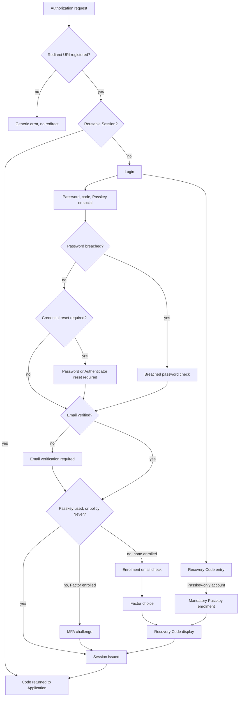

# Gatekeep: Experience Spine

## Foundation

Gatekeep has three web surfaces (Hosted Login, the Account Portal and the Admin Dashboard), plus Operator tooling with no UI. No UI library is named; components come from the Design System export, and `DESIGN.md` is the visual reference.

| Surface | Audience | Form factor | Accessibility bar |
| --- | --- | --- | --- |
| Hosted Login and Account Portal | Users, on each Tenant Subdomain | Desktop and mobile browsers (NFR-17), following the device's colour scheme | WCAG 2.2 AA (NFR-16) |
| Admin Dashboard | Admins, on its own hostname, VPN only | Desktop-first, responsive to tablet, light and dark (FR-44) | See Accessibility Floor |
| Operator tooling | The Operator | Command line and documentation | Not a UI surface |

**Precedence.** The PRD decides what ships (PRD §0). `DESIGN.md` decides how it looks. This file decides how it behaves. All three win over the exports. A designed control isn't a v1 commitment.

**Reading the tables.** Terms follow PRD §3 exactly. Screen status is one of:

- **Drawn:** the export has the screen.
- **Drawn, changed:** the export has it, and the Design Delta alters it.
- **Spec only:** the PRD requires it (§7.3) and no export draws it. It's composed from existing components, with no new visual language.

Copy in Hosted Login error and success cells comes from the exports unless tagged `[ASSUMPTION]`. All empty-state copy and every behaviour on a Spec-only screen is proposed here and open to correction. The export shows almost no loading, empty or error states, so most state treatments in this file are specified rather than extracted.

## Information Architecture

### Hosted Login

Users enter from an Application's authorization request, or from an email link. There is no navigation: each screen has one next step, and the server decides which step may come next (FR-47). The Account Portal is reached from a link an Application provides, and it has three tabs: Profile, Security and Sessions (FR-35). The Portal signs Users in through the normal flow, bound to a hidden system Application in each Tenant. It authenticates by Session cookie and isn't an OIDC client (AD-12).

What Login shows depends on the Connections enabled for the Application. The outcome never depends on the identifier (FR-17, NFR-20).

| Condition | Login shows | After Continue |
| --- | --- | --- |
| Password, alone or with others | Email field plus any other enabled buttons | Password step, with "Email me a code" if email code is enabled |
| Email code, no password | Email field plus any other enabled buttons | Email code entry |
| Passkey or social only | Those buttons, no email field | Not applicable |
| No Connections | Generic error | Not applicable |
| Sign-up disabled | "Sign up" link hidden (FR-17) | No change |
| Any | "Use a recovery code" link, always | Recovery Code entry, which asks for email and code |
| Reusable Session (FR-14) | Login is skipped, unless `prompt=login` or `max_age` requires it | Not applicable |

### Admin Dashboard

Top bar: brand, Tenant switcher, help (opens API reference), theme toggle, avatar menu. Global search and the alerts bell are v2 and aren't shown. The current Tenant name and environment badge appear on every page (FR-9).

Landing: with no Tenants, a Deployment Owner gets the create-Tenant form. Otherwise, the current Tenant's Applications list (FR-44). A Deployment Owner holding no Tenant Role lands on Tenants. Any other Admin with no Tenant Role sees "You don't have access to a Tenant yet. Ask a Deployment Owner." `[ASSUMPTION]`

The v1 sidebar has nine groups. Only v1 items appear, so groups can't end up empty (FR-44). The Deployment group is shown only to Deployment Owners; everything else is visible to every role, since Viewers can read all configuration (FR-39).

| Group | Items |
| --- | --- |
| Applications | Applications, APIs, Quickstarts |
| Authentication | Database, Social, Email code, Passkeys |
| User management | Users, Roles |
| Authorization | RBAC |
| Security | Multi-factor auth, Attack protection, Signing keys, Incident response |
| Branding | Hosted Login, Email templates, Email provider |
| Monitoring | Logs, Health & rate limits |
| Settings | Tenant, Management API, API reference |
| Deployment | Tenants, Admins, Deployment email provider, Deployment incident response, Deployment Log |

Five design labels change: "Universal Login" becomes Hosted Login (§7.3); "Team & audit" becomes Admins, because audit is a Log filter; "Passwordless" becomes Email code, because magic link is deferred; "API keys" becomes Management API; and "Email & SMS providers" becomes Email provider. Tenant security content moves into Tenant settings, since sessions are the only v1 content left on that page.

The avatar menu holds Your credentials and Sign out. "+ Create Tenant" appears in the Tenant switcher and on Tenants, for Deployment Owners only.

## Voice and Tone

Plain, specific and calm. Brand voice lives in `DESIGN.md`. Gatekeep speaks to two readers, so it uses two registers.

| Surface | Do | Don't |
| --- | --- | --- |
| Hosted Login | "Enter your password" | "Oops! Let's get you logged in" |
| Hosted Login | "That code is incorrect." | "Invalid OTP" |
| Hosted Login | "If an account exists for that email, we've sent a link." `[ASSUMPTION]` | "No account with that email" |
| Admin Dashboard | "Old secret valid for 24h." | "Secret rotation was completed successfully!" |
| Admin Dashboard | "Must be an absolute URL." | "Please enter a valid value" |

**Rules:**

- Never reveal whether an identifier exists (NFR-20). Failure copy is the same for wrong password and unknown account.
- Hosted Login errors show no internal detail beyond an error code and trace ID (FR-33).
- Say what happened and what to do next, in that order. On Generic error, use fixed text: the code and trace ID are the only variable detail.
- Admin copy uses real units and values. Destructive confirmations state the effect, including token impact.
- Use the Tenant's name, never "Gatekeep", on Hosted Login.
- Keep all text separable for translation (NFR-19).

## Component Patterns

Behavioural rules only. Visual specs are in `DESIGN.md`. Components not listed, such as `button-secondary`, `button-ghost`, `checkbox`, `badge-status`, `json-viewer`, `top-bar` and `sidebar`, follow standard control behaviour with `focus-ring`.

| Component | Behaviour |
| --- | --- |
| `button-primary`, `hosted-button-primary` | One per page or card. Enter submits it. While pending it keeps its width and accessible name, sets `aria-busy` and `aria-disabled`, and ignores further clicks. |
| `button-destructive` | Always leads to `modal`. Never acts on one click. |
| `input`, `hosted-input` | Validates on blur, then on change once in error, updating the helper text silently. Focus moves only on submit. Error text is linked with `aria-describedby`, and the field sets `aria-invalid`. |
| Field search | One field `select` plus a value, on Users and Logs (FR-30, FR-40). Users: email, user ID, Connection, status `[ASSUMPTION]`. Logs: event type, User, Application, outcome, time range `[ASSUMPTION]`. Values stay in the URL. Query syntax is v2. |
| `toggle` | Changes form state only. The page's Save commits it. |
| `segmented` | Selects immediately within the form. Arrow keys move. |
| `tabs` | URL addressable. Unsaved changes prompt before leaving. |
| `table` | Row click opens detail. Copy controls inside rows don't open it. Paged at 50 rows `[ASSUMPTION]`. |
| Copy control | Copies, shows "Copied" for 2 seconds, announces it through `role="status"`. |
| `code-block` | Read-only, with Copy in the header. Quickstart blocks never contain a secret (FR-43). |
| `toast` | Confirms a completed action. Admin: 2.4 seconds, as in the export. Portal: a `role="status"` region that stays until the next action, and never over the focused control. Never carries an error or a value to copy. |
| `banner` | Persistent page-level state, such as a Save failure or read-only notice. |
| `modal` | One level deep. Esc and Cancel close it. Focus is trapped, then returns to the trigger, or to the next row or section heading if the trigger is gone. |
| `drawer` | Log event detail. Esc closes it. Viewers see no raw detail (FR-39). |
| `empty-state` | One line of explanation and one action. Roles that can't take the action see no button. |
| `menu` | Opens on click or Enter. Arrow keys move, Esc closes. Used for the Tenant switcher, avatar menu and User actions. |
| Tenant switcher | Flat list of Tenants the Admin has a Tenant Role in (FR-9). Switching reloads the page in the new Tenant. Unsaved changes prompt first. |
| Re-authentication gate | Covers every action in the fresh-assertion list (FR-46). If the last assertion is over 5 minutes old, the browser's WebAuthn sheet appears when the Admin confirms. Destructive actions go `modal` first, then sheet, with failure shown inside the same modal. No second modal opens. |
| Typed confirmation | Confirm stays disabled until the value matches exactly. Used for User and Tenant deletion. The helper names what to type. |
| One-time reveal | A new secret appears once, in a modal with Copy. Close stays disabled until the Admin ticks "I've copied this". It can never be shown again (FR-12). |
| `hosted-card` | Holds one step. Focus follows the rule in Accessibility Floor. |
| Identifier chip | Shows the entered email and wraps, never truncates. Edit returns to the identifier step with the email kept. |
| `code-input` | Email and TOTP codes. Visible label "Verification code". `inputmode="numeric"`, `autocomplete="one-time-code"`. Accepts paste. Spaces are stripped. Never auto-submits: the button or Enter submits, since each try spends a limited attempt. |
| `code-input-recovery` | Recovery Codes. Visible label "Recovery code". Helper "Format: XXXX-XXXX". `inputmode="text"`, `autocapitalize="characters"`, `autocomplete="off"`, `spellcheck="false"`. Hyphens and spaces are normalized before any length check. |
| `strength-meter` | Updates locally as the User types, with rules from the Connection's policy. Unmet rules use a distinct glyph and the text "not met". A debounced `role="status"` announces the label. The breach check runs on the server at submit only, so no partial password leaves the browser. |
| Password field | Masked, with a `type="button"` toggle named "Show password" or "Hide password". Re-masks on submit. Paste allowed. Password managers are never blocked. |
| `method-row` | Whole row is the button. Shows only methods the User enrolled or the Tenant allows. |
| `social-button` | Named "Continue with {provider}". Pending on press, then leaves for the provider. Return is handled by the Social return row. |
| `recovery-code-block` | Codes are a real list, read in order. Copy returns all codes. Download saves `{tenant}-recovery-codes.txt` `[ASSUMPTION]`. Browser Back after Continue doesn't show them again. |
| Resend link | Uses `aria-disabled` for 30 seconds `[ASSUMPTION]` so focus stays, with a visual countdown outside live regions. "New code sent" and availability are announced once through `role="status"`. Doesn't reset the attempt count (FR-22). |
| `status-icon` | Decorative, `aria-hidden`. The heading carries the meaning. |
| Passkey prompt | The browser's own sheet. Gatekeep draws nothing. Cancelling returns to the card with no error. |

## State Patterns

### Global states

These apply wherever the per-screen tables don't say otherwise.

| State | Admin Dashboard | Hosted Login |
| --- | --- | --- |
| Page loading | `skeleton` rows in the content area, shell stays visible. Appears after 300ms. | Sign-in cards arrive complete `[ASSUMPTION]` (architecture to confirm). Account Portal tabs use `skeleton`. |
| Action pending | Button spinner. Form stays visible and read-only. | Same. |
| Save succeeded | `toast` | Moves to the next step. |
| Save failed | `banner` above the form, with values kept. | Inline error under the field, or above the form if not field-specific. |
| Field invalid | Inline, under the field. The save is blocked. | Same. Focus moves to the first invalid field. |
| Empty list | `empty-state` with one action. | Not applicable. |
| No search results | "No results" `[ASSUMPTION]` and a Clear filters action. | Not applicable. |
| Forbidden action | Viewer sees values read-only, with no action buttons, and a `banner`: "You have view-only access to this Tenant." Editor sees Tenant Owner controls read-only, labelled "Tenant Owner only" `[ASSUMPTION]`. See Role Capabilities. | Not applicable. |
| Forbidden page | Deployment group isn't listed. A direct URL shows "You don't have access to this page." with the trace ID. `[ASSUMPTION]` | Generic error. |
| Not found | "This no longer exists." with a link to the list `[ASSUMPTION]`. | Generic error. An unknown Tenant Subdomain gets a generic rejection and never reaches a Tenant (FR-7). |
| Tenant deleted or role removed mid-session | The next request returns to the landing page with a `banner` `[ASSUMPTION]`. | Not applicable. |
| Tenant mismatch | Action rejected. `banner` names both Tenants, with Reload (FR-9). | Not applicable. |
| Session expired | WebAuthn sheet on the next action, with a `banner` explaining why. Unsaved form values remain. | A warning appears 2 minutes before a sign-in transaction ends, with "Keep going". On expiry, restart at Login with the email kept. See Accessibility Floor. |
| Rate limited | `banner` with a retry time. | Same message as a wrong attempt where the limit would otherwise reveal an account (FR-28). |
| Service failure | `banner` with trace ID and Retry. | Generic error with code and trace ID. |
| Offline | Browser default. Writes fail with the Save failed state. | Browser default, accepted. |
| JavaScript off | Not supported. | Password and code forms work `[ASSUMPTION]`. WebAuthn needs JavaScript. |

### Hosted Login: sign-in

| Screen | Status | Loading | Empty or initial | Error | Success |
| --- | --- | --- | --- | --- | --- |
| Login | Drawn, changed | Continue spinner | Per the Login table in Information Architecture. Email focused. Passkey autofill active. | Malformed email: "Enter a valid email address." `[ASSUMPTION]` | Next step, whatever the account's state (FR-17) |
| Password step | Drawn, changed | Log in spinner, with timing padded (NFR-20) | Chip plus empty password, with the email in a read-only `username` field in the same form | "Incorrect email or password." `[ASSUMPTION]`, same for unknown accounts | MFA challenge, Factor enrolment or the Application |
| Passkey sign-in | Drawn | Browser sheet | Started from the button or autofill | Cancelled: back to Login, no error. Failed: "That passkey didn't work. Try again or use another method." `[ASSUMPTION]` | Signed in. No further step (FR-25) |
| Email code entry | Drawn, changed | Continue spinner | "Check your email" `[ASSUMPTION]`, with a neutral confirmation. Attempts count down identically when no code was sent (NFR-20). | "That code is incorrect. 2 attempts left." Expired: "This code has expired. Request a new one." After 5 failures: "Too many attempts. Try again at {time}, or use another method." `[ASSUMPTION]` | MFA challenge, or the Application |
| MFA method picker | Spec only | None | Enrolled methods: Passkey, security key, TOTP, Recovery Code | None | The chosen challenge |
| TOTP challenge | Spec only | Verify spinner | "Enter the 6-digit code from your authenticator app" (Admin L1052) | "That code is incorrect." Reused codes get the same text. Backoff: "Too many attempts. Try again at {time}, or use another method." `[ASSUMPTION]` | Signed in |
| Security key challenge | Drawn, changed | Browser sheet | "Use your security key" | Cancelled: stays here. Failed: "That key didn't work." `[ASSUMPTION]` | Signed in |
| Recovery Code entry | Spec only | Verify spinner | From Login: email and `code-input-recovery`, with "No codes? Recover by email". From the MFA method picker: code only. | "That code isn't valid." `[ASSUMPTION]`, identical for unknown accounts and accounts that aren't Passkey-only. Backoff as on TOTP. | As the second step: signed in, with notification. From Login: succeeds only for a Passkey-only account, which must then enrol (FR-27). Otherwise no code is consumed. |
| Re-authentication | Spec only | Browser sheet or Verify spinner | "Confirm it's you" `[ASSUMPTION]`, strongest enrolled method only (FR-35) | Failure as on the matching challenge. Recovery Code and email code aren't offered while a stronger method exists. | Returns to the action |

### Hosted Login: enrolment

| Screen | Status | Loading | Empty or initial | Error | Success |
| --- | --- | --- | --- | --- | --- |
| Signup | Drawn, changed | Create account spinner | Empty, with any email typed on Login carried over. Terms row only if a terms URL is set (FR-17). | Field errors from Validation Rules. Breach and policy failures show under the password. | Email verification, identical for new and existing addresses |
| Email verification required | Drawn | Resend sends and starts the countdown | "Verify your email to continue" | "I've verified" pressed too early: "We haven't seen that yet. Check your inbox." `[ASSUMPTION]` | Email verified |
| Email verified | Drawn, changed | Link processed server-side | Not applicable | Expired or used link: Link expired | Same browser: Passkey creation. Other browser: "Log in" starts a new request for the Application stored with the link. With no return address: "You can close this page." `[ASSUMPTION]` |
| Passkey creation | Drawn | Browser sheet | "Create a passkey". Tenant can turn the prompt off (FR-21). | Cancelled: stays here, "Not now" available unless Always needs enrolment. Unsupported device: skipped, or Factor choice under Always. | Recovery Code display, first enrolment only |
| Enrolment email check | Spec only | Verify spinner | `code-input`, "Confirm it's your email" `[ASSUMPTION]`. Shown before first-Factor enrolment at sign-in. Skipped straight after signup verification, which already proved email control. | As Email code entry | Factor choice. The code isn't a Factor (FR-25). |
| Factor choice | Drawn, changed | None | Rows: "Passkey", "Security key", "Authenticator app". Tenant's allowed set only. | None | Passkey creation, Security key setup or TOTP setup |
| TOTP setup | Drawn | Verify spinner | Numbered steps, QR with text alternative, labelled "Setup key" with Copy, "Open in authenticator app" link on phones, code field | "That code is incorrect." The seed stays until the screen closes. | Recovery Code display on first enrolment, otherwise onward |
| Security key setup | Drawn, changed | Browser sheet | "Use your security key" | Cancelled: stays here. Already registered: "This key is already set up." `[ASSUMPTION]` | As above |
| Recovery Code display | Drawn, changed | None | 8 codes, Copy, Download, unchecked confirmation | Continue pressed unticked: "Confirm you've saved your codes." `[ASSUMPTION]` on the checkbox | Onward. Codes never reappear. |

### Hosted Login: recovery

| Screen | Status | Loading | Empty or initial | Error | Success |
| --- | --- | --- | --- | --- | --- |
| Forgot password | Drawn | Send spinner, timing padded | Email carried over from earlier steps | Malformed email only | Neutral confirmation |
| Neutral confirmation | Spec only | None | "If an account exists for that email, we've sent a link." `[ASSUMPTION]` | None | Back to login |
| Reset password | Drawn | Reset spinner | New and confirm fields, meter | Policy, breach or mismatch errors. Bad link: Link expired. | Password changed |
| Password changed | Drawn, changed | None | Not applicable | None | "Log in" only, with the email kept if the reset began in this browser. No Session exists (FR-19). Other browser: as Email verified. |
| Link expired | Spec only | None | "This link has expired or was already used." with "Send a new link" | None | Neutral confirmation, so NFR-20 holds |
| Credential enrolment | Spec only | Link processed | Opened from the link an Admin passed on. "Set up a new passkey" `[ASSUMPTION]`. No Session exists yet. | Expired or used link: Link expired, with no "Send a new link" | Passkey creation, then Recovery Code display |
| Email recovery waiting | Spec only | None | Under Never, a Passkey-only User uses Forgot password, and the neutral confirmation is unchanged. The email offers recovery. Opening it shows "Your recovery starts in 24 hours." `[ASSUMPTION]` | None | The notification email carries a cancel link. After 24 hours, a second email links to enrol a new Passkey (FR-27) |

### Hosted Login: protection and exit

| Screen | Status | Loading | Empty or initial | Error | Success |
| --- | --- | --- | --- | --- | --- |
| Blocked account | Drawn | None | Shown only after valid credentials (FR-28). "Contact support" uses the Tenant's support contact. | No support contact set: action hidden | None |
| Account locked | Drawn, changed | None | Shown only after valid credentials, with a retry time. A valid Passkey still works. | None | Reset password, or wait out the backoff |
| Breached password check | Drawn, changed | Change spinner | User verifies a Factor, or gets a reset link. No Session yet (FR-29). | Same rules as Reset password | With a verified Factor: sign-in continues after the new password. By reset link: ends at Password changed. |
| Password reset required | Spec only | Row spinner | Shown only after valid credentials, or a sign-in by social or email code, when the User's password must be replaced (FR-50). "Reset your password", "{Tenant} requires a new password before you can sign in." `[ASSUMPTION]` `method-row` per enrolled proof, plus "Email me a reset link". Old TOTP and a Recovery Code count as proof here. No Session yet. A Passkey sign-in skips the proof and goes straight to the new password. | Proof fails as on the matching challenge, with the same backoff. New password: same rules as Reset password. | With proof: new password, then onward. By link: Neutral confirmation, then ends at Password changed with no Session. Any completed reset clears this requirement. |
| Authenticator reset required | Spec only | Verify spinner | Shown after the first factor when the User's TOTP must be replaced (FR-50). "Set up your authenticator again" `[ASSUMPTION]`, with `method-row` for the old TOTP code, a Recovery Code, or any other enrolled Factor. A Passkey sign-in, or proof just given on Password reset required, skips this and goes straight to TOTP setup. The old code works once, only to reach TOTP setup. Email is never offered (FR-25). | "That code is incorrect.", with the same backoff. No proof left: "Contact support" uses the Tenant's support contact, and FR-31 applies. | TOTP setup, then onward. The old seed stops working once the new one is confirmed. Recovery Codes aren't reissued. |
| Logout | Drawn | Log out spinner | "Log out of {Tenant}?" | Invalid `id_token_hint`: logs out, shows the Logged out state without redirecting | Redirect to a registered URL, or "You're logged out." `[ASSUMPTION]` |
| Social return | Spec only | Provider redirect | Not applicable | Cancelled at the provider: back to Login, no error. Provider failure: Generic error. Provider asserts no verified email: "We couldn't confirm your email with {provider}." `[ASSUMPTION]` | Signed in, or Social email conflict (FR-20) |
| Social email conflict | Spec only | None | "This email is already in use." `[ASSUMPTION]`, with a link to the existing method | None | User signs in the existing way |
| Generic error | Drawn, changed | None | "Something went wrong", fixed text, code and trace ID | Tenant custom error page gets only code and trace ID (FR-10) | Back to the Application |

### Account Portal

| Screen or tab | Status | Loading | Empty or initial | Error | Success |
| --- | --- | --- | --- | --- | --- |
| Profile | Drawn, changed | Skeleton | Avatar shows initials | Field errors. Email change pending: `banner` until verified. | `toast`. Old address can reverse an email change for 72 hours (FR-35). |
| Security | Drawn, changed | Skeleton | "No passkeys yet", with Add. Recovery Codes shown as "6 of 8 left". | Removing the last method under Always is refused, with the reason (FR-26). | Sensitive changes pass Re-authentication first, keeping typed values except passwords. Notification always sent. |
| Sessions | Drawn, changed | Skeleton | Only the current Session: "This is your only session." `[ASSUMPTION]` | Revoke failure: `banner` | Row disappears. "Sign out all" keeps the current Session (FR-48). |
| Change password | Drawn | Spinner | Re-authentication first, then new password with meter | Same rules as Reset password | `toast`. Other Sessions end (FR-48). |
| Add or remove Passkey or Factor | Drawn, changed | Browser sheet | Uses the matching setup screen | As the setup screen | `toast`, focus moves to the next row. First-ever enrolment shows Recovery Code display. |
| Regenerate Recovery Codes | Drawn | Spinner | Warns that old codes stop working | Re-authentication failure | Recovery Code display. Other Sessions end. |
| Email change landing | Spec only | Link processed | Verify link on the new address | Link expired | "Email updated." `[ASSUMPTION]` |
| Email change reversal | Spec only | Link processed | Link on the old address, valid 72 hours | Link expired | Change reversed, Sessions end, sign in required `[ASSUMPTION]` |
| Delete account | Drawn, changed | Spinner | Inside Security, in the red panel | Re-authentication failure | Signed out, "Your account is deleted." `[ASSUMPTION]` |

### Admin: access and Tenants

All Spec only. Screens before an Admin session exists use `hosted-card` in the Gatekeep default theme. The rest use the Admin shell.

| Screen | Loading | Empty or initial | Error | Success |
| --- | --- | --- | --- | --- |
| Bootstrap | Spinner | One-time token field. Refuses all Tenant traffic until done (FR-2). | Wrong token or used path: Generic error. | Two WebAuthn credentials, before any change |
| Admin sign-in | Browser sheet | "Sign in with your security key or passkey." `[ASSUMPTION]` No email or password field. "Use a recovery code" link. | Cancelled: stays here. Failed: "That credential wasn't recognised." `[ASSUMPTION]` | Landing page. A Recovery Code leads only to Admin credential setup (FR-46). |
| Admin invite acceptance | Spinner | Inviter, invited email, Tenant Roles | Expired, used or wrong email: Generic error | Credential setup |
| Admin credential setup | Browser sheet | Register one, then a second or an offline Recovery Code. The first Admin must register two WebAuthn credentials (FR-2). | Cancelled: stays here. Can't leave until complete (FR-46). | Landing page |
| Your credentials | Skeleton | List of the Admin's credentials, with Add and Remove | Removing the last credential is refused | `toast` |
| Admin sign-out | Spinner | From the avatar menu | None | Admin sign-in |
| Admin re-authentication | Browser sheet | Modal naming the action and Tenant | Failed: action not performed | Action proceeds |
| Tenants | Skeleton | Deployment Owner only. Lists all Tenants, with Create Tenant. | Global | Row opens the Tenant |
| Create Tenant | Spinner | Name, Tenant Subdomain, label. No Region. | Subdomain taken, reserved or malformed. Never says whether taken or reserved. `[ASSUMPTION]` | Applications list, empty |

### Admin: Tenant screens

Each row adds to the global states. Skeleton loading applies throughout.

| Screen | Status | Empty | Error | Success |
| --- | --- | --- | --- | --- |
| Applications | Drawn, changed | "No applications yet" with Create application | Global | Detail page |
| Create Application | Spec only | Name and type: single-page, regular web, native, machine-to-machine | Duplicate names allowed. Missing name inline. | Tenant Owner: one-time reveal if the type needs a secret. Editor: the Application is created with no secret, and Credentials says a Tenant Owner must create one. Then Quickstart tab. |
| Application · Settings | Drawn, changed | No URLs: helper explains exact match | URL errors per line. Prod custom scheme needs acknowledgement. | `toast`. Prod callback change re-authenticates and raises a Security Alert. |
| Application · Credentials | Drawn, changed | Single-page and native show "No secret needed." `[ASSUMPTION]` | Rotate failure: `banner` | One-time reveal, with "End old secret now" during overlap. Tenant Owner only. |
| Application · Connections | Drawn | "No Connections enabled. Users can't sign in." `banner` `[ASSUMPTION]` | Global | `toast` |
| Application · Tokens | Drawn, changed | Defaults shown | Over limit: "Maximum is 1 hour." `[ASSUMPTION]` | `toast` |
| Application · Quickstart | Drawn, changed | Five frameworks. Client ID only. | None | Copy |
| Delete Application | Drawn | `modal` states the token effect. FR-11 needs no typed confirmation. | Global | Back to list |
| APIs | Drawn, changed | Management API always listed, so never empty | Duplicate identifier inline | Detail page |
| API detail | Drawn, changed | "No permissions yet" with Add. Settings: identifier (locked after creation), access token lifetime, offline access, Enable RBAC. | Global | `toast` |
| Quickstarts | Drawn, changed | None | None | Opens the guide |
| Database · Settings | Drawn, changed | Sign-up toggle only (FR-17) | Global | `toast` |
| Database · Password policy | Drawn, changed | Defaults shown | Below floor: "Minimum is 12 characters." `[ASSUMPTION]` | `toast`. Preview updates live. |
| Database · Applications | Drawn | "Not used by any application" | None | Links to Application |
| Social | Drawn, changed | Google, GitHub, Microsoft, all off, each needing credentials | Test connection failure shows the provider's error code | `toast` |
| Email code | Drawn, changed | Off by default. Settings: Enabled, and whether it creates accounts (FR-22). | Provider not set: `banner` links to Email provider `[ASSUMPTION]` | `toast` |
| Passkeys | Drawn, changed | Settings: Enabled, and the prompt after email verification (FR-21) | Global | `toast` |
| Users | Drawn, changed | "No users yet" with Create user | Empty field value inline | Detail page |
| Create User | Spec only | Email, then send verification | Duplicate email in this Tenant inline (Admin only; not a User-facing path) | `toast`, user detail |
| User · Details | Drawn, changed | Missing values shown as "—" | Global | `toast` |
| User · Sessions | Drawn | "No active sessions" | Global | Row disappears, `toast` |
| User · Roles | Drawn, changed | "No roles assigned" with Assign | Global | `toast` |
| User · MFA | Drawn, changed | "No Factors or Passkeys" | Global | Reset uses `modal`, then `toast`. For a Passkey-only User, a one-time reveal shows a single-use enrolment link to pass on outside the product (FR-27). |
| User · History | Drawn | "No events yet" | Global | None |
| User · Actions menu | Drawn, changed | Items depend on status: Block or Unblock | Global | Block and Delete use `modal`. Delete is typed. |
| Export or erase User | Spec only | Tenant Owner only | Global | Export downloads. Erasure confirms it keeps the Log record (FR-49). |
| Roles | Drawn, changed | "No roles yet" with Create role | Duplicate name inline | Role detail |
| RBAC | Drawn, changed | Needs an API with Permissions: empty state links to APIs | Global | `toast` |
| Multi-factor auth | Drawn, changed | Never, with both Factors allowed. Under Never, also holds email recovery for Passkey-only Users (FR-27). | Lowering needs re-authentication | `toast`, Log entry, Security Alert |
| Attack protection | Drawn, changed | Defaults shown | Over limit inline | `toast` |
| Signing keys | Drawn, changed | Always has next and current, so never empty | Rotate or revoke failure: `banner` | Revoke modal offers Session revocation (FR-38) |
| Incident response | Spec only | Tenant Owner. Three actions, each with its effect stated: revoke all Sessions and refresh tokens; force password resets and TOTP re-enrolment; send a security notice to all Users. | Re-authentication failure | Progress `banner`, then `toast` and Log entry. Partial failure lists what didn't finish, with Retry. |
| Deployment incident response | Spec only | Deployment Owner. The same actions across every Tenant, plus revoke all Signing Keys. | As Incident response | As Incident response, per Tenant. Deployment Log entry. |
| Hosted Login | Drawn, changed | Gatekeep default theme. Preview shows login, signup, MFA, reset and error, in light and dark. | Contrast failure names the pair and scheme. Logo type or size inline. | Publish `toast`. Draft kept until published. |
| Email templates | Drawn, changed | Five default templates, each with subject, body text and a fixed variable list | Missing link or code variable, or an unknown variable, blocks Save (FR-36) | Save `toast`. Test send reports SPF, DKIM, DMARC. |
| Email provider | Drawn, changed | "No provider set" with Add | Test send failure shown inline | Re-authenticates. Security Alert. `toast`. |
| Logs | Drawn, changed | "No events in this range" | Global | Row opens `drawer` |
| Logs · Event drawer | Drawn | Viewer: summary only | Global | Copy JSON |
| Health & rate limits | Drawn, changed | Zero usage shown as 0. Shows service status, email provider status and per-Tenant rate-limit usage. | Status fetch failure: `banner` | Live values |
| Tenant | Drawn, changed | Defaults shown. Holds display name, support contact, session lifetimes, default audience, error page, terms URL, and Dev-only email verification off (FR-10, FR-17). | Over limit inline. Prod label removal re-authenticates. | `toast`. Export downloads a file with no secrets (FR-41). |
| Delete Tenant | Spec only | Deployment Owner only, on Tenants. Typed confirmation and re-authentication. | Global | Back to Tenants list |
| Admins | Drawn, changed | Columns: Admin, Deployment Owner, Tenant Roles per Tenant, credentials count, last active. Only the current Admin at first. | Last Deployment Owner can't be removed | Invite sent `toast`. Removal lists their Management API clients. "Reset credentials" issues a single-use enrolment (FR-46). |
| Management API | Drawn, changed | "No clients have access". Lists clients, grants and last use. Tenant Owner grants only. | Global | Re-authenticates. Security Alert. |
| Deployment Log | Spec only | Always has bootstrap events | Global | As Logs |
| Deployment email provider | Spec only | Deployment Owner only. "No provider set" with Add. Needed before Admins can be invited. | Test send failure shown inline | Re-authenticates. Security Alert. `toast`. |
| API reference | Spec only | Shipped with the release | None | Opens the reference |

### Role Capabilities

This maps FR-39 to surfaces. Every role can read all Tenant pages. Hiding is never the control (NFR-5).

| Surface or action | Viewer | Editor | Tenant Owner | Deployment Owner |
| --- | --- | --- | --- | --- |
| Applications, APIs, Roles, Users, theme, templates | Read | Manage | Manage | With a Tenant Role |
| Tenant settings, Connection on or off, configuration export | Read | Manage | Manage | With a Tenant Role |
| Raw Log detail | Summary only | Yes | Yes | With a Tenant Role |
| Client secrets, password policy, MFA policy, Connection credentials, email provider, Tenant label | Read | Read, "Tenant Owner only" | Manage | With a Tenant Role |
| Signing Keys, Management API grants | Read | Read, "Tenant Owner only" | Manage | With a Tenant Role |
| Export or erase User, Incident response | None | None | Yes | With a Tenant Role |
| Tenants, Admins, Deployment email provider, Deployment incident response, Deployment Log | None | None | None | Yes |

## Validation Rules

All rules run on the server. Browser checks are feedback only (NFR-5). Numeric limits live in PRD §5.2, because they're starting points (A-12). Messages state the current limit. Numbers elsewhere in this file are the current §5.2 defaults, and §5.2 wins if they differ.

### Hosted Login

| Field | Rule | Message | `autocomplete` |
| --- | --- | --- | --- |
| Email on Login | Trimmed, one `@`, valid domain shape. No existence check. | "Enter a valid email address." `[ASSUMPTION]` | `username webauthn` |
| Email on Signup | As above | As above | `username` |
| Password, current | Required | "Incorrect email or password." `[ASSUMPTION]` | `current-password` |
| Password, new | At least the Connection minimum, never below the §5.2 floor. Plus strength, history, dictionary and personal-data rules from policy (FR-18). | Named rule under the field | `new-password` |
| Password, new | Not in the local breach dataset, at sign-up, reset and change (FR-29). | "This password appeared in a data breach." | |
| Confirm password | Must equal the new password. | "Passwords don't match." `[ASSUMPTION]` | `new-password` |
| Terms | Required only when the Tenant sets a terms URL. Version and time recorded. Links sit outside the `label`. | "Accept the terms to continue." `[ASSUMPTION]` | |
| Email code | Digits only, length, expiry and attempts per §5.2. A new code doesn't reset the count (FR-22). | "That code is incorrect. {n} attempts left." | `one-time-code` |
| TOTP code | 6 digits. Can't be reused inside its window (FR-26). | "That code is incorrect." | `one-time-code` |
| Recovery Code | `XXXX-XXXX`, case-insensitive, hyphen optional, single use. | "That code isn't valid." `[ASSUMPTION]` | `off` |
| Display name | 1–100 characters `[ASSUMPTION]`. | Inline | `name` |
| New email | Valid email. Effective after verifying the new address. | Inline | `email` |

### Admin Dashboard

| Field | Rule | Message |
| --- | --- | --- |
| Tenant Subdomain | Lowercase letters, numbers and hyphens (Admin L210). 3–63 characters `[ASSUMPTION]`. No reserved name. Never reused. Can't change after creation. | "Lowercase letters, numbers and hyphens." |
| Callback, logout and origin URLs | Absolute. Matched exactly, no wildcards. One per line. Loopback port exception for native Applications. | "Must be an absolute URL." |
| Custom URI scheme | Native only. Needs acknowledgement in a Prod Tenant. | Inline checkbox |
| Any lifetime or threshold | Bounded by the §5.2 hard limit. Thresholds can't be off. Password minimum can only be raised. | "Maximum is {limit}." `[ASSUMPTION]` |
| API identifier | Unique in the Tenant. Locked after creation. Guidance to use different identifiers per environment (FR-16). | Inline |
| Permission | `resource:action`, as in the design `[ASSUMPTION]`. Unique per API. | Inline |
| Theme colour | Hex. Passes the DESIGN.md Tenant theme validation, in both schemes (FR-34). | Names the failing pair and scheme |
| Logo | PNG or SVG, sanitized, 64×64 minimum. Size limit 1 MB `[ASSUMPTION]`. | Inline |
| Email template | Must contain the system link or code. Only listed variables. No remote content (FR-36). | Names the variable |
| Typed confirmation | Exact match of the User's email or the Tenant Subdomain. | Button stays disabled |

## Interaction Primitives

**Admin Dashboard.** Keyboard-reachable throughout. Esc closes the topmost layer. Tab moves in reading order. Enter submits. Mouse hover shows the row affordance; nothing is hover-only. The export's ⌘K belongs to global search, which is v2.

**Hosted Login.** One decision per screen. Enter advances. Browser autofill and password managers always work. Back is safe: a stale step shows the current valid step or the Generic error (FR-47).

**Banned everywhere:** drag and drop in v1, infinite scroll, modals over modals, and any control for a deferred feature (FR-33, FR-44).

## Accessibility Floor

Visual contrast lives in `DESIGN.md`. The exports have no focus styles or ARIA at all (`design-consistency.md` AD-1, AD-2), so everything here must be built, not extracted. All fixes are tokens, attributes or copy, and no visual redesign is needed.

### Hosted Login and Account Portal, WCAG 2.2 AA (NFR-16)

**Focus.** Every control takes `focus-ring`. Focus lands by this precedence:

1. A page with an error: the first invalid field, or the error container with `tabindex="-1"` if it isn't field-specific.
2. Login on first load: the email field.
3. Any other step: the card heading.

**Pages.** `<title>` is "{step heading} – {Tenant}", prefixed "Error:" after a failed submit. `html` has `lang="en"`. One `main` landmark.

**Errors and status.** `role="alert"` applies to errors injected after load, on submit only. After a full page load, moved focus does the announcing. Colour is never the only signal, and links inside sentences are underlined.

**Authentication (3.3.8).** Passwords and codes are cognitive function tests, allowed through the mechanism exception. So paste, autofill and password managers must work on every credential field, including the two-step form. Passkey and email code are extra paths where enabled. No CAPTCHA.

**Redundant entry (3.3.7).** The email carries over from Login to Signup, to Forgot password, back from Edit, and to Log in after Password changed in the same browser. It never reveals account status.

**Time limits (2.2.1).**

- The sign-in transaction lasts 30 minutes `[ASSUMPTION]`, sliding on each step, which exceeds the code lifetime and allows slow setup with assistive technology.
- A warning appears 2 minutes before it ends, as a `role="alertdialog"` with "Keep going", which extends it without a reload.
- On expiry, sign-in restarts at Login with the email kept, not at Generic error.
- Code and link lifetimes are recorded as essential security limits, with "request a new code" or "send a new link" as the way forward.
- Account locked gives an absolute retry time, not a ticking one.

**Targets.** Controls are at least 44px. Checkboxes, radios and inline actions such as Show, Edit, Remove and Sign out have a hit area of at least 24px.

**Non-text.** The TOTP QR is `role="img"`, labelled "QR code for your authenticator app. Can't scan it? Use the setup key below." The setup key has a visible label, and Copy returns it unspaced. Logos have `alt` text. Repeated actions have unique names, such as "Remove passkey MacBook Pro".

**Reflow and motion.** 200% zoom and 320px reflow work without horizontal scroll. The identifier chip wraps. Code and Copy rows stack. Reduced motion removes `gkIn`.

### Admin Dashboard

The PRD sets no WCAG level. Floor: every control is operable by keyboard with `focus-ring`, tables use real table semantics, tabs use the ARIA tab pattern, and modals trap focus.

## Responsive & Platform

| Width | Admin Dashboard | Hosted Login |
| --- | --- | --- |
| ≥ 1100px | Full sidebar, manual light and dark toggle | Centred card, system colour scheme |
| 768–1099px | Icon rail. Tables scroll horizontally inside their card. Drawer max 50%. | Centred card |
| < 768px | Unsupported (NFR-17) | Card fills width. Account Portal rail becomes tabs. |

## Design Delta

Changes the implementation makes against the exports, one row per surface. The exports stay as they are. This applies PRD §7.3 and FR-33 and FR-44 to specific controls. "Drawn, changed" in State Patterns means the surface has a row here.

### Hosted Login

| Surface | Remove | Change |
| --- | --- | --- |
| All screens | | Dark colour scheme added, on `-dark` tokens. All text in `tx2`. |
| Login | "Continue with company SSO", Apple button | Provider buttons limited to Google, GitHub, Microsoft. Add "Use a recovery code". |
| Password step | "add a passkey" hint, since the step can't vary by account (FR-17) | Add "Email me a code" when enabled |
| Signup | "Not found in known breaches" tick, which can't be known before submit; "Add a symbol for Excellent" sample | Terms row uses the Tenant's single terms URL. Password masked by default. |
| Email code entry | "Use email instead", magic link fallback | "Check your phone" becomes "Check your email", showing the entered address |
| Factor choice | "Gatekeep Verify app", "Text message" | "Passkey or security key" splits into two rows |
| Security key | | Copy drops "gold contact" |
| SMS and code screens | "Remember this device", "Call me instead" | |
| Recovery Code display | | Copy becomes "If you lose your device, each code works once. We won't show them again." `[ASSUMPTION]` |
| Email verified | | "Continue" changes as the Email verified state row specifies |
| Password changed | | "Back to {Tenant}" becomes "Log in" |
| Account locked | Unlock link, since the email can't undo an Admin block (FR-28) | |
| Breached password | "We never saw your password…" | "Checked against a list of known breached passwords stored on this server." `[ASSUMPTION]` |
| Generic error | | Fixed text |
| Account Portal | Connected apps and Privacy tabs, Verify app row, delete-account promise of a data copy | Three tabs |

### Admin Dashboard

| Surface | Remove | Change |
| --- | --- | --- |
| Top bar | Global search, alerts bell | Help opens API reference. Tenant switcher is flat. |
| Sidebar | Overview group; every item outside the IA table | |
| Get started, Home | Whole pages | Create Tenant replaces them |
| Applications | Dynamic registration, SDK column, AI agent and Third-party filters | |
| Application · Settings | Domain, Logo URL, CORS origins; Implicit, Password, Device, CIBA and Token Exchange grants; wildcard copy | Exact-match URLs in the samples |
| Application · Credentials | Private Key JWT, mTLS, public keys, Reveal | One-time reveal |
| Application tabs | Organizations, Add-ons | |
| Application · Tokens | Signing algorithm, rotation and reuse toggles, reuse interval | Default lifetimes follow §5.2, not 36000 seconds |
| Application · Quickstart, Quickstarts | Express, Django and Spring tabs as drawn; `@gatekeep/*` packages; client secret line; other frameworks | React, Next.js, Node, .NET, Python, on standard OIDC libraries |
| APIs | HS256 row, Algorithm column, "Allow skipping user consent", "User consent policy", Partner Portal sample | One fixed asymmetric algorithm. Machine-to-machine table stays. |
| Database | Custom database and Import tabs; require username; identifier types | Password levels below the floor go. Good and Excellent stay, redefined on top of the minimum `[ASSUMPTION]`. |
| Social | Dev keys copy, scopes, sync profile, other providers | Google, GitHub, Microsoft |
| Enterprise, Self-service SSO, SCIM | Whole pages | |
| Email code (Passwordless) | Authentication method, OTP length and expiry, "Max 3 attempts", SMS tab, editable template | §5.2 values are fixed. Renamed. |
| Passkeys | Stats, autofill toggle, Local enrollment, User verification and Attestation selects | User verification and no attestation are fixed (FR-21) |
| Users | Import, Export, bulk bar, Organization filter, lucene label, query bar | Field search |
| User detail | Linked accounts, metadata editors, Impersonate, "Change password", "Generate recovery code", Organizations tab | |
| Roles, RBAC | Organization-based sample roles | |
| Multi-factor auth | Adaptive, step-up, remember browser; push, SMS, voice, email, biometrics, Duo; override copy | Never and Always. TOTP and WebAuthn security key. |
| Attack protection | Bot detection, IP throttling, allowlist, Security Center link, Notify only, admin digest, Also check at signup toggle | Brute-force thresholds and breached detection, on at all times |
| Tenant security | Whole page | Session lifetimes move to Tenant |
| Signing keys | Expires column | Add Retired state. JWKS sample includes Previous. |
| Hosted Login editor | Widget position, background, Advanced panel, custom domain row, consent and org picker previews | Renamed. Dark primary colour field added. Preview in both schemes. |
| Email templates | Liquid, welcome, MFA enrolment, passwordless and invitation templates, redirect, link lifetime | Five templates: verification, password reset, one-time code, account locked, security notification. Subject and body text with a fixed variable list. |
| Email provider | "Custom: Send via an Action", phone provider | Email only |
| Logs | Live, Log streams, query bar, SIEM sentence | Field search. Retention reads 90 days. |
| Health | Region, Log streams and Custom domains rows, "of 1M" quota, uptime | Adds email provider status and per-Tenant rate limits |
| Tenant | Region, Logo URL, default directory, Advanced OIDC block | Adds terms URL, session lifetimes, Export |
| Team (Admins) | Support and "Admin" roles, MFA column, Dashboard access panel, Audit log tab, impersonation sample | Moves to Deployment. Columns as the Admins state row lists. |
| API keys (Management API) | "+ Create token", token explorer, test tokens | Lists clients, grants and last use |
| All | Sample domains using `gatekeep.dev` or `.us.` | Tenant Subdomains |

## Key Flows

Protagonists follow the PRD and the people named in the exports. UJ names are verbatim.

The server enforces this order for every sign-in (FR-47). No state can be reached by URL. The diagram shows the v1 branches; blocked, locked and backoff states can interrupt any credential step after valid credentials or failures, as the state tables say.

### Flow 1: Login (Priya, returning User with a password and a security key)

1. Priya's app redirects them to Hosted Login. Login shows only the Connections enabled for that Application.
2. Priya enters their email and presses Continue.
3. The password step shows their address in the identifier chip, as it would for any address.
4. Priya enters their password.
5. Gatekeep checks the password against the breach dataset. It's clean.
6. Priya's Tenant uses Always, so Security key challenge appears. Priya touches the key.
7. **Climax:** the Session is issued with a new identifier, and the app receives a code. Priya never saw a screen that told an attacker anything.

Failures: wrong password shows "Incorrect email or password." A blocked or locked state appears only after correct credentials. A breached password leads to Breached password check, and no Session exists until a new password is set. An expired transaction restarts at Login with the email kept.

### Flow 2: Signup (Felix, a new User; realizes part of UJ-2)

1. Felix follows "Sign up" from Login.
2. Felix enters an email and password. The meter updates as they type.
3. If the Tenant set a terms URL, Felix accepts it.
4. Felix presses Create account. The server checks policy and breaches.
5. Email verification required appears. No Session exists yet.
6. Felix opens the link. Email verified appears.
7. Passkey creation is offered. Felix creates one.
8. Recovery Code display appears. Felix saves the codes and ticks the box.
9. **Climax:** Felix lands in the app, signed in, with a Passkey and saved codes.

Failures: an existing address gets the same screens, and the owner gets a notice email. An expired or used link shows Link expired, with "Send a new link". A Dev Tenant may turn verification off.

### Flow 3: Passwordless with an email code (Tomás, on a borrowed laptop)

v1 passwordless is email code and Passkey. Magic link and SMS are deferred.

1. Tomás enters their email on Login, then chooses "Email me a code" on the password step. If the Application has no password Connection, this step is skipped.
2. Email code entry says a code was sent, showing the address. This appears whether or not the account exists.
3. Tomás opens the email and enters the 6 digits.
4. **Climax:** Tomás is signed in on a machine that holds none of their credentials.

Failures: a wrong code shows attempts left. After 5, the code is dead, and a new code doesn't reset the count. If the Tenant set this Connection not to create accounts, an unknown address sends nothing and shows the same screen. Under Always, an email code alone never completes sign-in, so the MFA challenge follows.

### Flow 4: Passkeys (Maya; UJ-2. Maya signs in and secures their account)

1. Maya signs up with an email address and verifies it, as in Flow 2.
2. Passkey creation appears. Maya presses Create passkey and approves the browser prompt.
3. Recovery Code display appears, since this is Maya's first enrolment. Maya saves the codes.
4. Next visit: Maya presses "Sign in with a passkey", or autofill offers it. No account lookup happens first.
5. **Climax:** one Passkey prompt, and Maya is in. No Factor step follows, because a user-verified Passkey satisfies Always.

Failure, device lost: Maya chooses "Use a recovery code" on Login and enters their email and a code. This succeeds only for a Passkey-only account. Anyone else gets "That code isn't valid.", and no code is used, so a Recovery Code can never stand in for a password. The code replaces the sign-in. Maya must enrol a new Passkey, gets a notification, and finds all other Sessions ended (FR-27, FR-48). With both lost under Always, a Tenant Owner or Editor resets Maya's credentials after checking identity outside the product, and passes on a single-use enrolment link. Under Never, a Tenant may allow email recovery, which waits 24 hours (see Email recovery waiting).

### Flow 5: MFA enrolment (Priya, after a Tenant moves to Always)

1. Priya signs in with a password as usual. They have no Factor.
2. Enrolment email check sends a code to Priya's verified address. Priya enters it. A stolen password alone stops here (FR-25).
3. Factor choice appears: "Secure your account. Northwind requires a second step at sign-in."
4. Priya chooses Authenticator app.
5. TOTP setup shows a QR and setup key. Priya scans it and enters a code.
6. Recovery Code display appears. Priya saves the codes.
7. **Climax:** sign-in completes, now with a second factor, and Priya gets a notification.

Failures: a wrong code keeps the seed so Priya can retry. If the email provider is down, enrolment waits, and Priya sees Generic error. If the Tenant disallows a Factor, those who rely on it enrol a replacement at next sign-in.

### Flow 6: MFA challenge (Aiko, using TOTP with a dead security key)

1. Aiko passes the first factor. Security key challenge appears, as their strongest method.
2. Aiko has no key today and presses Try another method.
3. MFA method picker lists their enrolled methods: security key, authenticator app and Recovery Code.
4. Aiko chooses Authenticator app and enters a code.
5. **Climax:** Aiko is in, without having used a Recovery Code.

Failures: repeated failures back off, separately per method, and survive a new challenge (FR-28). A used TOTP code is refused. Email can't bypass this step (FR-25).

### Flow 7: Reset password (Maya, who forgot it)

1. On the password step, Maya presses "Forgot password?".
2. Forgot password opens with their email filled in. Maya presses Send reset link.
3. Neutral confirmation appears, identical for unknown addresses.
4. Maya opens the link, valid for 30 minutes and single use.
5. Reset password takes a new password that passes policy and breach checks.
6. Password changed confirms it. All Sessions and Token Families have ended (FR-48).
7. **Climax:** Maya presses Log in and signs in again, including any Factor. The reset itself never signed anyone in.

Failures: an expired, used or superseded link shows Link expired, with "Send a new link". A password that fails stays on the form.

### Flow 8: UJ-1. Esm adds sign-in to a new project

1. Esm signs in with WebAuthn. With no Tenants, the create-Tenant form appears.
2. Esm names the Tenant, picks its Tenant Subdomain and label, and lands on an empty Applications list.
3. Esm creates a regular web Application and copies the secret from the one-time reveal.
4. Esm enters the callback URL, enables password and Passkey on Connections, and opens the Quickstart tab.
5. Esm runs the app and signs in as a test User.
6. **Climax:** the app receives a valid token.

Failure: a mismatched callback URL shows Generic error at Gatekeep, and never redirects.

### Flow 9: UJ-3. Esm responds to a suspected key compromise

1. A Security Alert arrives outside the Deployment. Esm opens Logs.
2. Esm opens Signing keys and chooses Revoke on the current key.
3. The modal states the token impact and offers to revoke Sessions and refresh tokens.
4. Esm confirms and touches their security key.
5. **Climax:** the next key is promoted at once, tokens signed by the revoked key are rejected within 15 minutes, and no other Tenant is touched.

Failure: if revocation fails, a `banner` shows the trace ID, the key stays as it was, and nothing is half-applied.

### Flow 10: UJ-5. Esm's service calls an API

1. Esm creates a machine-to-machine Application.
2. On the API, Esm authorizes it and selects Permissions.
3. The job requests a token with Client Credentials.
4. **Climax:** the token carries only those Permissions, and the API rejects anything else.

Failures: a token request for an ungranted Permission returns a token without that Permission. A Permission removed from the grant is gone from the next token (FR-16).

### Flow 11: Social sign-in (Jonas, returning with Google)

1. Jonas presses "Continue with Google" on Login.
2. Google authenticates them and returns to Gatekeep.
3. Gatekeep matches the provider's issuer and subject, never the email.
4. **Climax:** Jonas is signed in, with any required Factor step first.

Failures: per the Social return row. A verified email matching another account shows Social email conflict, which creates nothing.

### Flow 12: Portal sensitive change (Maya, replacing a lost security key)

1. Maya opens Security in the Account Portal and presses Remove on the old key.
2. Re-authentication asks for their strongest enrolled method. Maya uses their Passkey.
3. The key is removed. A notification goes out, and other Sessions end (FR-48). Maya's Session continues.
4. **Climax:** the lost key can't sign anyone in, and Maya never left the page.

Failures: removing the last method under Always is refused. Re-authentication failure changes nothing.

### Flow 13: First Admin bootstrap (Esm, on a fresh Deployment)

1. Esm reads the one-time token on the server and opens the Admin hostname over VPN.
2. Bootstrap takes the token.
3. Admin credential setup registers two WebAuthn credentials.
4. **Climax:** Esm lands on the create-Tenant form as Deployment Owner, and the bootstrap path is dead.

Failures: a wrong token shows Generic error. Other Admins join through Admin invite acceptance, then Admin credential setup.

### Flow 14: Tenant Incident response (Esm, after a suspected password leak)

1. Esm opens Security, then Incident response.
2. Esm chooses force password resets and TOTP re-enrolment. The modal states the effect on Users.
3. Esm confirms and touches their security key.
4. A progress `banner` runs.
5. Esm sends a security notice to all Users.
6. **Climax:** every User must prove themselves again, and the Log shows who ordered it.

Failures: a partial failure lists what didn't finish, with Retry.

### Flow 15: Forced reset at sign-in (Priya, after Flow 14)

1. Priya enters their email and current password as usual.
2. Password reset required appears. No Session exists yet.
3. Priya chooses their security key and touches it. Their authenticator app would also count here.
4. Priya sets a new password that passes policy and breach checks.
5. Authenticator reset required doesn't ask again, because the security key already proved it's Priya. TOTP setup shows a new QR, and Priya confirms a code.
6. **Climax:** the Session is issued, and anything taken in the leak is dead. Priya never relied on their mailbox alone.

Failures: with no Factor, or by choice, Priya uses the reset link, which ends at Password changed. They then sign in with the new password, and any TOTP step follows. If a restore brought back an old password, Priya's newer one is refused with "Incorrect email or password.", and Forgot password clears the requirement. A User with a Passkey skips the proof. Email never replaces a Factor (FR-25).

### Operator journeys without a UI

UJ-4 (Esm upgrades Gatekeep and recovers from a failure) and UJ-6 (Esm responds to a compromised server) happen at the command line and in runbooks. Their Admin Dashboard touchpoints are Incident response, the Deployment Log and the first-run bootstrap.

## Deferred Flows (v2 Reference)

The owner requested these three flows, and the design draws them, but PRD §7.2 defers them. They satisfy no v1 requirement, and FR-33 forbids their controls in v1. They're recorded here so the design intent survives until v2. Copy is from the exports. Their states are proposed, and later PRD changes may supersede them.

### Flow R1: Organization invitation (Dana, invited to Acme Corp)

1. Maya sends an invite from Organization · Invitations, with email, role and expiry.
2. Dana gets the Invitation email and opens the link.
3. Invitation acceptance shows "Join Acme Corp", the inviter, the email and the role.
4. Dana presses "Accept with Acme SSO" and signs in at the organization's IdP.
5. **Climax:** Dana lands in the app as a Member of Acme Corp.

| State | Treatment |
| --- | --- |
| Loading | Button spinner |
| Expired or used | Generic error, "ask for a new invitation" `[ASSUMPTION]` |
| Wrong account | Signed-in email differs from the invite: Organization picker's "Use a different account" `[ASSUMPTION]` |
| Success | Organization picker on later sign-ins, if a member of several |

### Flow R2: Third-party consent (Maya, connecting Zendesk)

1. Zendesk starts an authorization request.
2. Maya signs in if needed.
3. Consent shows both logos, "Zendesk wants access to your Northwind account", the scopes, and the third-party notice.
4. Maya presses Allow.
5. **Climax:** Zendesk receives only what Maya saw and agreed to.

| State | Treatment |
| --- | --- |
| Loading | Allow spinner |
| Decline | Returns to the client with `access_denied` `[ASSUMPTION]` |
| Already granted, same scopes | Skips the screen `[ASSUMPTION]` |
| Unregistered client | Generic error |
| Success | Revocable from Connected apps, itself deferred |

### Flow R3: Device activation (Felix, signing a CLI in)

1. Felix's terminal shows a code and the activation address.
2. Felix opens it on a phone, signed in or signing in.
3. Device activation shows "Enter the code shown on your TV or terminal."
4. Felix enters the eight-character code, such as `BKDQ-WXZT`.
5. Felix confirms the request.
6. **Climax:** the terminal signs in, without a password ever being typed into it.

| State | Treatment |
| --- | --- |
| Loading | Continue spinner |
| Initial | Eight cells, charset Base20 (Admin L1294), "Only enter codes from devices you own." |
| Wrong or expired code | "That code isn't valid or has expired." `[ASSUMPTION]`, rate limited |
| Success | "You can close this window." `[ASSUMPTION]` |

## Screen-to-PRD Map

Every screen in `design/SCREENS.md`, plus the Spec-only screens. "—" means no v1 requirement.

### Hosted Login

| Screen | Requirements | Release |
| --- | --- | --- |
| Theme variants | FR-34, NFR-16 | v1 |
| Login · identifier first | FR-17, FR-14, FR-20, FR-21, FR-22, FR-33, NFR-20 | v1 |
| Login · password step | FR-17, FR-18, FR-28, FR-29, NFR-20 | v1 |
| Passkey sign-in prompt | FR-21, FR-25 | v1 |
| Signup · password strength | FR-17, FR-18, FR-29, NFR-20 | v1 |
| Progressive profiling (Form) | — | v2, §7.2 |
| Passkey create | FR-21, FR-27 | v1 |
| Email / SMS code entry | FR-22, FR-28 | v1, email only |
| Magic link sent | — | v2, §7.2 |
| Enroll · choose a factor | FR-25, FR-26 | v1, changed |
| TOTP · scan QR | FR-26 | v1 |
| Push · check your phone | — | Non-goal, §6 |
| SMS code | — | Non-goal, §6 |
| WebAuthn security key | FR-26 | v1, setup and challenge |
| Recovery codes | FR-27 | v1 |
| Step-up challenge | — | v2, §7.2 |
| Forgot password | FR-19, NFR-20 | v1 |
| Reset password | FR-18, FR-19, FR-29, FR-48 | v1 |
| Password changed | FR-19, FR-48 | v1 |
| Email verification required | FR-17 | v1 |
| Email verified | FR-17, FR-21 | v1 |
| Organization picker | — | v2, §7.1 |
| Invitation acceptance | — | v2, §7.1 |
| Consent · third-party app | — | v2, §7.2 |
| Account linking prompt | — | v2, §7.1 |
| Device activation (TV / CLI) | — | v2, §7.1 |
| Agent approval (CIBA) | — | Later, §7.1 |
| Blocked account | FR-28, FR-31 | v1 |
| Brute-force lockout | FR-28 | v1, as Account locked |
| Breached password warning | FR-29, FR-25 | v1 |
| CAPTCHA challenge | — | v2, §7.1 |
| Logout confirmation | FR-24 | v1 |
| Generic error | FR-33, FR-10, FR-13, FR-47 | v1 |
| Self-service account portal | FR-35, FR-26, FR-27, FR-48, NFR-14 | v1, three tabs |
| MFA method picker | FR-26, FR-27 | v1, Spec only |
| TOTP challenge | FR-26, FR-28 | v1, Spec only |
| Recovery Code entry | FR-27, FR-28, FR-48 | v1, Spec only |
| Re-authentication | FR-35 | v1, Spec only |
| Neutral confirmation | FR-19, NFR-20 | v1, Spec only |
| Link expired | FR-17, FR-19, NFR-20 | v1, Spec only |
| Enrolment email check | FR-25 | v1, Spec only |
| Social return | FR-20, FR-33 | v1, Spec only |
| Social email conflict | FR-20, NFR-20 | v1, Spec only |
| Email change landing, Email change reversal | FR-35 | v1, Spec only |
| Email recovery waiting | FR-27 | v1, Spec only |
| Credential enrolment | FR-27, FR-31 | v1, Spec only |
| Password reset required | FR-50, FR-4, FR-25, FR-48 | v1, Spec only |
| Authenticator reset required | FR-50, FR-25, FR-26 | v1, Spec only |

### Admin Dashboard: shell and v1

| Screen | Requirements | Release |
| --- | --- | --- |
| Top bar | FR-9, FR-44 | v1, changed |
| Tenant switcher menu | FR-9 | v1, flat list |
| Global search results | — | v2, §7.1 |
| Sidebar | FR-44 | v1, changed |
| Section page template | FR-44 | v1 |
| Section blocks: stats, note, table, settings, code, cards, bars | FR-44, NFR-18 | v1 |
| Confirmation modal | FR-31, FR-46 | v1, changed |
| Toast | NFR-18 | v1 |
| Bootstrap | FR-2 | v1, Spec only |
| Admin sign-in | FR-46 | v1, Spec only |
| Admin invite acceptance | FR-39, FR-46 | v1, Spec only |
| Admin credential setup | FR-2, FR-5, FR-46 | v1, Spec only |
| Admin re-authentication | FR-46 | v1, Spec only |
| Create Tenant | FR-7, FR-44 | v1, Spec only |
| Tenants | FR-7 | v1, Spec only |
| Delete Tenant | FR-7, FR-46 | v1, Spec only |
| Your credentials, Admin sign-out | FR-46 | v1, Spec only |
| Create Application | FR-11 | v1, Spec only |
| Create User | FR-31 | v1, Spec only |
| Export or erase User | FR-49 | v1, Spec only |
| Applications | FR-11 | v1 |
| Application detail | FR-11 | v1 |
| Application · Settings | FR-11, FR-13 | v1, changed |
| Application · Credentials | FR-12 | v1, changed |
| Application · Connections | FR-14 | v1 |
| Application · Tokens | FR-15 | v1, changed |
| Application · Quickstart | FR-43 | v1, changed |
| APIs | FR-16, FR-42 | v1, changed |
| Quickstarts | FR-43 | v1, five |
| Database | FR-17, FR-18 | v1 |
| Database · Settings | FR-17 | v1, changed |
| Database · Password policy | FR-18 | v1, changed |
| Database · Applications | FR-14 | v1 |
| Social | FR-20 | v1, changed |
| Passwordless | FR-22 | v1, as Email code |
| Passkeys | FR-21 | v1, changed |
| Users | FR-30, FR-31 | v1, changed |
| User detail | FR-30 | v1 |
| User · Actions menu | FR-31, FR-49 | v1, changed |
| User · Details | FR-30 | v1, changed |
| User · Sessions & devices | FR-30, FR-31 | v1 |
| User · Roles & permissions | FR-32 | v1 |
| User · MFA | FR-30, FR-31 | v1, changed |
| User · History | FR-30, FR-40 | v1 |
| Roles | FR-32 | v1 |
| RBAC | FR-16, FR-32 | v1 |
| Multi-factor auth | FR-25 | v1, changed |
| Attack protection | FR-28, FR-29 | v1, changed |
| Signing keys | FR-37, FR-38 | v1, changed |
| Incident response, Deployment incident response | FR-50, FR-46 | v1, Spec only |
| Universal Login | FR-34 | v1, as Hosted Login |
| Universal Login · Preview screens | FR-34 | v1, five screens |
| Email templates | FR-36 | v1, changed |
| Email & SMS providers | FR-36 | v1, email only |
| Logs | FR-40 | v1, changed |
| Logs · Event drawer | FR-40, FR-39 | v1 |
| Health & rate limits | FR-6 | v1, changed |
| Tenant | FR-10, FR-7, FR-41 | v1, changed |
| Team & audit | FR-39, FR-40 | v1, as Admins |
| API keys | FR-42 | v1, as Management API |
| Deployment Log | FR-40 | v1, Spec only |
| Deployment email provider | FR-39 | v1, Spec only |
| API reference | FR-43 | v1, Spec only |

### Admin Dashboard: not in v1

| Screen | Release |
| --- | --- |
| Get started, Get started · Tenant step, Get started · App type step, Get started · Login methods step, Get started · Quickstart step | v2 wizard. Tenant step's form becomes Create Tenant without Region. |
| Home | v2 |
| Application · Organizations | v2 |
| Application · Add-ons | v2 |
| Database · Custom database | v2 |
| Database · Import users | v2 |
| Enterprise, Enterprise · LDAP variant | v2; LDAP later |
| Self-service SSO, SCIM provisioning | v2 |
| Users · Bulk action bar | v2 |
| User · Organizations & apps | v2 |
| Organizations, Organization · Members, Organization · Invitations, Organization · Connections, Organization · Login experience, Organization · Metadata | v2 |
| Import / export jobs | v2 |
| Fine-grained (FGA) | Later |
| Multi-factor auth · Adaptive panel | v2 |
| Security center | v2 |
| Tenant security | v2 for sender-constrained tokens; session settings move to Tenant |
| Flows & editor, Action editor · Code, Action editor · Secrets, Action editor · Dependencies, Action editor · Versions, Action editor · Test | Flow builder later; Actions v2 |
| Library | v2 |
| Forms, Marketplace | Later; Marketplace is a non-goal (§6) |
| Token exchange | v2 |
| Rules & Hooks (legacy) | Never (§6) |
| Agents, Token vault, Async authorization, RAG authorization, MCP servers | Later |
| Custom domains | v2 |
| Log streams, Analytics | v2 |
| Environments | v2 |
| Billing | Never (§6) |
| Compliance & privacy | Export and erasure move to User actions (FR-49); certifications never (§6) |
| Config as code | v2; FR-41's export sits in Tenant |
| API explorer, JWT & OIDC tools | v2 |
| Support | v2; §6 excludes a vendor support centre |

### Requirements without a dedicated screen

| Requirement | Why |
| --- | --- |
| FR-1, FR-3, FR-4, FR-5, FR-45 | Operator tooling, documentation or alert channel. FR-5 ends at Admin credential setup. |
| FR-8, FR-23, FR-47 | Enforced by the server. Visible only as Generic error or the sign-in order. |
| NFR-1 to NFR-15, NFR-20, NFR-21 | Delivered below the UI. NFR-14 surfaces through FR-49; NFR-20 is in the Voice and Tone rules. |
| NFR-16 to NFR-19 | Covered by the Accessibility Floor, Responsive & Platform, `DESIGN.md` and Voice and Tone. |

## Visual References

The exports illustrate composition only. The precedence in Foundation applies. No mockups were produced, because the visual design is final. [`design-consistency.md`](design-consistency.md) lists how the exports differ from the Design System.

| File | Illustrates |
| --- | --- |
| [Design System](../../../../design/Gatekeep%20Design%20System.dc.html) | Tokens, components, states |
| [Admin](../../../../design/Gatekeep%20Admin.dc.html) | Admin shell and pages |
| [Hosted Login](../../../../design/Gatekeep%20Hosted%20Login.dc.html) | Every Hosted Login screen, in two themes |
| [SCREENS.md](../../../../design/SCREENS.md) | Locators for every screen |
| [design-prompt.md](../../../../design/design-prompt.md) | Original design scope |

