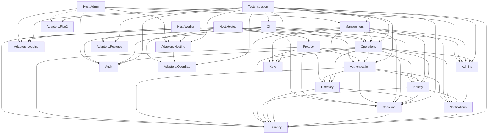

<!-- Generated from tests/Architecture/module-edges.txt. Do not edit. Regenerate: dotnet run --project tests/Architecture/Generator -->

# Module dependencies

Every solid arrow is one allowed direct dependency. Every dashed arrow is a composition root wiring a module's adapter registration. Transitive reach grants nothing. Every module and host may also reference Kernel, not drawn.

